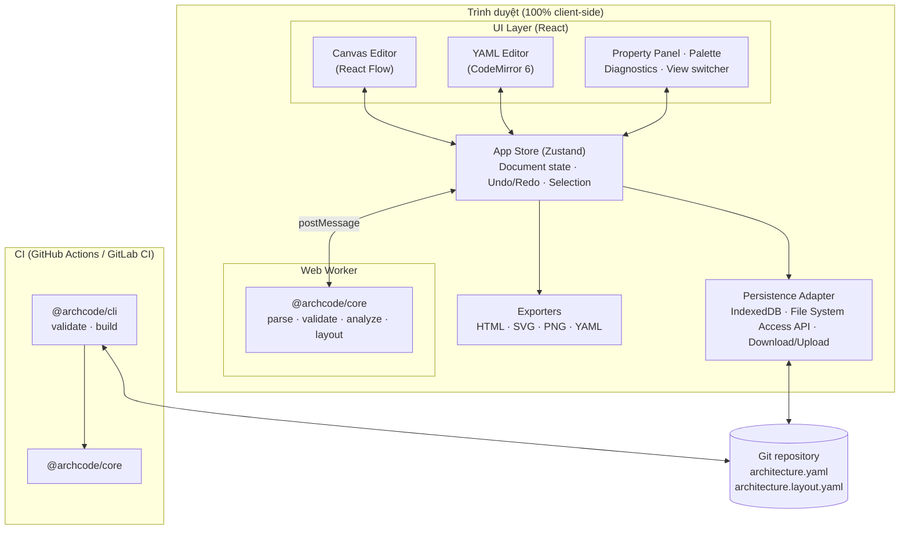
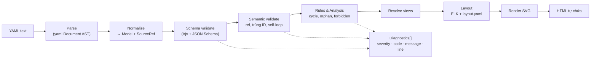
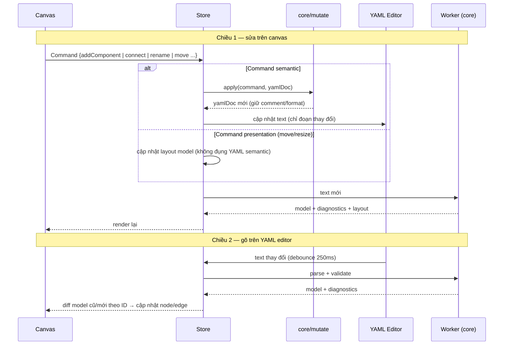

# ArchCode — Thiết kế kiến trúc & Lựa chọn Tech Stack

> Phiên bản: 0.1 · Ngày: 2026-10-10 · Trạng thái: Draft
> Tham chiếu: [01-feature-list.md](./01-feature-list.md)

---

## 1. Các yêu cầu định hình kiến trúc

| # | Yêu cầu | Quyết định kiến trúc tương ứng |
|---|---|---|
| 1 | YAML là source of truth (C-01) | Mọi thay đổi đều đi qua YAML AST; canvas chỉ là một view |
| 2 | Sinh HTML (C-02) | Pipeline thuần hàm: `YAML → Model → Layout → SVG → HTML` |
| 3 | Không server, chạy trên web (C-03) | SPA static; toàn bộ xử lý trong trình duyệt (main thread + Web Worker) |
| 4 | Dùng được trong CI (C-04) | Core là thư viện TypeScript thuần, không phụ thuộc DOM; CLI chạy trên Node |
| 5 | Diff Git sạch | Tách semantic model và presentation model ra hai file; ID ổn định |
| 6 | Kết quả deterministic | Cùng input → cùng layout → cùng HTML (không random, sắp xếp ổn định) |

---

## 2. Tổng quan kiến trúc

Ứng dụng là **static Single Page Application**. Không có backend; "server" chỉ là static hosting (GitHub Pages, S3, Nginx, Netlify…) phục vụ file JS/CSS/HTML.



**Điểm then chốt:** `@archcode/core` là một thư viện được dùng ở ba nơi — Web Worker, main thread (export) và CLI trên Node. Một logic duy nhất đảm bảo web và CI cho cùng kết quả.

---

## 3. Cấu trúc mã nguồn (monorepo)

```
archcode/
├── packages/
│   ├── core/                 # Thuần TypeScript, KHÔNG dùng DOM/Node API
│   │   ├── schema/           # JSON Schema + kiểu TS sinh ra
│   │   ├── parser/           # YAML → AST → Model (giữ vị trí dòng/cột)
│   │   ├── validator/        # schema + semantic validation
│   │   ├── analysis/         # cycle, orphan, impact, coupling
│   │   ├── rules/            # policy engine
│   │   ├── views/            # resolve view (include/exclude/filter)
│   │   ├── layout/           # auto-layout (ELK) + merge layout thủ công
│   │   ├── render/           # Model + Layout → SVG string
│   │   ├── export/           # HTML tự chứa, Markdown
│   │   ├── mutate/           # Command → patch YAML AST (giữ comment)
│   │   └── diff/             # semantic diff (V1)
│   └── cli/                  # archcode validate | build  (Node)
├── apps/
│   └── web/                  # React SPA (Vite)
│       ├── canvas/  editor/  panels/  store/  worker/  persistence/
└── docs/
```

Quy tắc phụ thuộc (sẽ tự kiểm bằng chính công cụ khi dogfooding):
`apps/web → packages/core` · `packages/cli → packages/core` · `packages/core` không phụ thuộc gì trong repo.

---

## 4. Mô hình dữ liệu

### 4.1 Tách hai lớp dữ liệu

| Lớp | File | Nội dung | Có vào semantic diff? |
|---|---|---|---|
| **Semantic model** | `architecture.yaml` | system, component, relationship, group, view, rule | Có |
| **Presentation model** | `architecture.layout.yaml` | vị trí, kích thước, waypoint của connector theo từng view | Không |

Di chuyển node chỉ thay đổi file layout. Nếu không có file layout, hệ thống auto-layout — vì vậy file layout là **tùy chọn**, YAML semantic luôn tự đủ để sinh HTML.

### 4.2 YAML DSL (bản nháp v1)

```yaml
version: 1

system:
  id: document-platform
  name: Document Platform
  description: Nền tảng upload và quản lý tài liệu

groups:                         # boundary: domain, cluster, trust zone
  - id: core
    name: Core Domain
    type: domain

components:
  - id: user
    name: End User
    type: person
  - id: api-gateway
    name: API Gateway
    type: gateway
    technology: Kong
  - id: document-service
    name: Document Service
    type: service
    group: core
    technology: Go
    owner: team-docs
  - id: document-db
    name: Document DB
    type: database
    group: core
    technology: PostgreSQL

relationships:                  # id tùy chọn; mặc định "<from>-><to>"
  - from: user
    to: api-gateway
    type: https
  - from: api-gateway
    to: document-service
    type: http
    label: REST /documents
  - from: document-service
    to: document-db
    type: sql

views:
  - id: overview
    name: Tổng quan
    include: ["*"]
    direction: LR
  - id: core-domain
    name: Core Domain
    include: ["group:core"]

rules:
  - id: no-cycles
    type: no-circular
    severity: error
  - id: no-cross-domain-db
    type: forbidden
    severity: error
    description: Service không truy cập DB của domain khác
    from: { type: service }
    to: { type: database }
    unless: same-group
```

**Component type có sẵn (theo C4):** `person`, `system`, `external`, `frontend`, `gateway`, `service`, `database`, `queue`, `storage`, `cache`. Type khác vẫn hợp lệ (custom type, cảnh báo nếu chưa khai báo trong `types:` — V1).

### 4.3 Presentation model

```yaml
# architecture.layout.yaml — sinh tự động khi người dùng kéo node
version: 1
views:
  overview:
    nodes:
      api-gateway: { x: 320, y: 120 }
      document-service: { x: 320, y: 300 }
    edges:
      api-gateway->document-service: { points: [[400, 200], [400, 260]] }
```

Mọi key đều là **stable ID**; node chưa có vị trí sẽ được auto-layout xung quanh các node đã cố định.

### 4.4 Model trong bộ nhớ (TypeScript)

```ts
interface ArchitectureModel {
  version: number;
  system: { id: string; name: string; description?: string };
  groups: Group[];
  components: Component[];
  relationships: Relationship[];   // id luôn được chuẩn hóa
  views: View[];                   // luôn có ít nhất view mặc định "*"
  rules: Rule[];
}
// Mỗi phần tử mang SourceRef { line, column } để nhảy từ canvas/diagnostic tới YAML.
```

---

## 5. Pipeline xử lý (core)



- Mỗi bước là **hàm thuần** (input → output), dễ test, dễ chạy trong worker và CLI.
- Lỗi không chặn pipeline nếu vẫn dựng được model một phần: phần tử lỗi bị bỏ qua khi render, diagnostics hiển thị song song.
- Lỗi cú pháp YAML: canvas giữ **bản model hợp lệ gần nhất** ở chế độ chỉ đọc cho đến khi YAML sửa xong.

---

## 6. Đồng bộ hai chiều Canvas ↔ YAML

Đây là phần khó nhất của MVP. Nguyên tắc: **chỉ có một nguồn sự thật là YAML Document (AST)**.



Chi tiết quan trọng:
- **Command pattern**: mọi thao tác canvas là một command có `apply` lên AST. Undo/redo lưu snapshot text YAML (+ layout) → một lịch sử chung cho cả hai editor.
- **Giữ comment & format**: dùng thư viện `yaml` (eemeli) thao tác trên `Document` AST thay vì `stringify` lại toàn bộ object.
- **Diff theo ID**: canvas không bị "nhảy" khi gõ YAML vì node khớp theo stable ID, vị trí cũ được giữ.
- **Đổi ID**: là command riêng (`renameId`) cập nhật đồng thời mọi tham chiếu trong relationships, views, rules và file layout.

---

## 7. Sinh HTML

Output là **một file `.html` duy nhất**, không phụ thuộc mạng:

| Thành phần | Cách làm |
|---|---|
| Diagram | SVG inline (mỗi view một SVG), zoom/pan bằng ~2KB JS inline |
| Tab view | Một tab cho mỗi view trong YAML |
| Tổng quan | Tên, mô tả hệ thống, thống kê số component/relationship |
| Bảng component | id, tên, type, công nghệ, group, owner, depends on, used by |
| Bảng relationship | from, to, type, label |
| Validation report | Lỗi/cảnh báo kèm số dòng, rule id |
| Nguồn | (Tùy chọn) YAML gốc nhúng trong `<script type="text/yaml">` để mở lại vào editor |
| Style | CSS inline, hỗ trợ in ấn (print → PDF) và dark mode |

Cùng hàm `generateHtml(model, layout, diagnostics)` chạy trên web (tải về qua Blob) và trong CLI (`archcode build architecture.yaml -o docs/architecture.html`).

---

## 8. Lưu trữ (không server)

| Cơ chế | Dùng cho | Ghi chú |
|---|---|---|
| **IndexedDB** | Autosave dự án, danh sách dự án gần đây | Mặc định |
| **File System Access API** | Mở thư mục repo đã clone, lưu trực tiếp `architecture.yaml` | Chrome/Edge; Git commit do người dùng làm |
| **Upload / Download** | Firefox, Safari | Fallback |
| **URL share** | Chia sẻ nhanh model nhỏ | YAML nén (lz-string) trong URL hash, không qua server |

---

## 9. Lựa chọn Tech Stack

### 9.1 Bảng chốt

| Hạng mục | Lựa chọn | Phương án đã cân nhắc | Lý do chọn |
|---|---|---|---|
| Ngôn ngữ | **TypeScript** (strict) | JavaScript | Model phức tạp, cần type an toàn; chia sẻ kiểu giữa core/web/cli |
| Monorepo | **pnpm workspaces** | npm workspaces, Nx, Turborepo | Nhẹ, nhanh, đủ cho 3 package; thêm Turborepo khi cần |
| Build web | **Vite** | Webpack, Next.js | Build static thuần, dev server nhanh, hỗ trợ Web Worker sẵn. Next.js bị loại vì thiên về server render |
| UI framework | **React 19** | Vue, Svelte, Vanilla | Hệ sinh thái canvas mạnh nhất (React Flow); dễ tuyển người |
| Canvas | **React Flow (@xyflow/react)** | JointJS, GoJS, AntV X6, Konva tự viết | Có sẵn zoom/pan/minimap/snap/custom node/edge; MIT; node là component React → dễ làm property panel. GoJS/JointJS+ tốn phí |
| YAML parser | **yaml (eemeli)** | js-yaml | Giữ comment, AST có vị trí dòng/cột, sửa AST rồi ghi lại — bắt buộc cho đồng bộ hai chiều |
| Schema | **JSON Schema + Ajv** | Zod | JSON Schema dùng lại được cho VS Code (yaml-language-server) và autocomplete trong editor; Ajv nhanh, chạy được trong worker |
| YAML editor | **CodeMirror 6** + `@codemirror/lang-yaml` | Monaco | Nhẹ (~300KB so với ~3MB của Monaco), mobile tốt, dễ gắn diagnostics/lint và autocomplete từ schema |
| Auto-layout | **ELK.js** (layered) | dagre, d3-force | Hỗ trợ group lồng nhau (compound), orthogonal edge, cố định một phần node; chạy trong worker. dagre giữ làm fallback nhẹ |
| State | **Zustand** | Redux Toolkit, Jotai | API gọn, dùng được ngoài React (worker bridge, command) |
| Worker RPC | **Comlink** | postMessage thủ công | Gọi hàm core trong worker như hàm async |
| Styling | **CSS Modules + CSS variables** | Tailwind | Tránh phụ thuộc build phức tạp; theme sáng/tối bằng biến CSS (dùng chung cho HTML export) |
| UI primitives | **Radix UI** | MUI, Ant Design | Không ép style, accessible, nhỏ |
| Lưu cục bộ | **idb-keyval** + File System Access API | localStorage, Dexie | Đơn giản, đủ cho dự án dạng document |
| Export PNG/PDF | SVG → Canvas → PNG; PDF qua `window.print()` (MVP), **svg2pdf.js** (V1) | Puppeteer | Puppeteer cần server — loại |
| CLI | **Node 20+**, `commander` | Deno, Bun | Phổ biến nhất trên CI runner |
| Test | **Vitest** (core), **Playwright** (E2E web) | Jest, Cypress | Cùng hệ Vite, nhanh; Playwright test được File System Access |
| Lint/format | **ESLint + Prettier** | Biome | Chuẩn phổ biến |
| Deploy | **GitHub Pages / Cloudflare Pages / S3** | — | Static hosting, không backend |

### 9.2 Ngân sách hiệu năng & dung lượng

| Chỉ số | Mục tiêu |
|---|---|
| Bundle tải ban đầu (gzip) | < 400 KB (ELK.js tải lazy trong worker) |
| Parse + validate 200 node | < 50 ms |
| Layout 200 node / 400 edge | ≤ 1 s (trong worker, không chặn UI) — điều chỉnh sau [spike ELK](./spikes/elk.md) |
| Kích thước HTML export | < 300 KB cho 100 component |

### 9.3 Hệ quả của việc "không server"

- **Bảo mật:** dữ liệu kiến trúc không rời máy người dùng — điểm bán hàng tốt với doanh nghiệp.
- **Chi phí vận hành:** gần như bằng 0; có thể chạy offline (PWA — V1).
- **Hạn chế:** không có realtime collaboration, OAuth, RBAC trong MVP → bù bằng luồng Git/PR (xem feature list mục 11).

---

## 10. Kiến trúc mở rộng (V1+)

```ts
// Plugin interface — đăng ký tại runtime, chạy cả web và CLI
interface ArchcodePlugin {
  name: string;
  componentTypes?: ComponentTypeDef[];   // shape, màu, icon, thuộc tính
  rules?: RuleDef[];                     // (model, ctx) => Diagnostic[]
  exporters?: ExporterDef[];             // (model, layout) => string | Blob
  importers?: ImporterDef[];             // (text) => ArchitectureModel
}
```

Các tính năng ở V1/V2 (semantic diff, Mermaid/Terraform import, AI) đều là plugin hoặc module của core → không cần đổi kiến trúc nền.

---

## 11. Rủi ro kỹ thuật & giảm thiểu

| Rủi ro | Mức | Giảm thiểu |
|---|---|---|
| Đồng bộ hai chiều làm mất comment/format YAML | Cao | Chỉ sửa qua AST của `yaml`; bộ test round-trip (parse → mutate → stringify) cho mọi command |
| Layout không ổn định, node "nhảy" giữa các lần render | Cao | Sắp xếp input theo ID; giữ vị trí từ layout file; ELK `interactive` mode |
| ELK.js nặng (~1.5MB) | Trung bình | Lazy load trong worker; dagre fallback cho model nhỏ |
| File System Access API không có trên Firefox/Safari | Trung bình | Fallback upload/download + IndexedDB |
| DSL thay đổi phá vỡ file cũ | Trung bình | Trường `version` + migration (AAC-09) ngay từ đầu |
| Model lớn (>1000 node) chậm trên canvas | Thấp (MVP) | Virtualization của React Flow, view lọc, chỉ render view hiện tại |
| **R-ROUTE-PERF** — libavoid-js chậm: route một view 50 node / 80 connector ~180 ms; 100 / 200 ~23 s; 200 / 400 ~16 s (đo lại sau đính chính, [spikes/libavoid.md](./spikes/libavoid.md)). Không tham số nào đưa view 100 node xuống dưới ~11 s. Có group thì nhanh hơn nhiều (100/200 ~1.7 s, 200/400 ~2.2 s) vì node trong group bị chặn được bỏ khỏi router — rủi ro tập trung ở **view lớn không có group**. Ảnh hưởng cả thao tác kéo (KPI 8) lẫn xuất SVG/HTML/CLI ở view lớn | Cao (KPI 8: 200/400 ≥ 50 fps; thời gian xuất) | Theo dõi trong S6-ROUTE-06/07. Phương án dự phòng: (0) ngưỡng cứng cho mọi nơi — view vượt ngưỡng (~50 connector) dùng router hiện tại kể cả khi xuất; (1) route hai tầng — router cũ khi kéo, libavoid trong Worker sau khi thả và khi xuất; (2) ngưỡng số connector, vượt ngưỡng chỉ dùng libavoid khi xuất; (3) router tự viết (lưới visibility + A*). Luôn giữ router cũ làm fallback (S6-ROUTE-07) |

---

## 12. Kế hoạch triển khai MVP (đề xuất)

| Sprint (2 tuần) | Nội dung | Kết quả kiểm chứng |
|---|---|---|
| 1 | Monorepo, core: schema, parser, validator, view resolver; CLI `validate` | YAML mẫu → diagnostics đúng dòng |
| 2 | core: layout (ELK), render SVG, `generateHtml`; CLI `build` | **YAML → HTML tự chứa** chạy được từ dòng lệnh |
| 3 | Web: YAML editor (CodeMirror) + preview SVG + diagnostics + export HTML | Bản web đầu tiên, chỉnh YAML → thấy diagram & tải HTML |
| 4 | Web: canvas React Flow, palette, property panel, command → YAML mutate | Kéo thả cập nhật YAML, giữ comment |
| 5 | Layout file, undo/redo, IndexedDB, File System Access, export PNG/SVG | Lưu/mở dự án, tái tạo đúng diagram |
| 6 | Rule cycle/orphan, templates, E2E test, deploy GitHub Pages | Đạt các KPI MVP |

> Sprint 1–3 đã cho ra một sản phẩm dùng được ("YAML → HTML trên web, không server"); sprint 4–6 bổ sung trải nghiệm visual-first.
