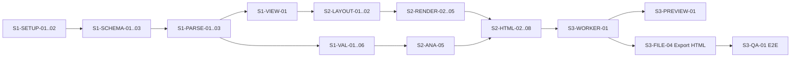

# ArchCode — Task breakdown Sprint 1–3

> Phiên bản: 0.1 · Ngày: 2026-10-10 · Trạng thái: Draft
> Tham chiếu: [01-feature-list.md](./01-feature-list.md) · [02-architecture-and-tech-stack.md](./02-architecture-and-tech-stack.md)

**Quy ước**
- Mỗi task ≤ 1 ngày công (ước lượng theo giờ: S = 2h, M = 4h, L = 8h).
- `Phụ thuộc` = task phải xong trước.
- Mỗi task chỉ được coi là xong khi đạt **tiêu chí hoàn thành (DoD)** và có test đi kèm (nếu là code core).
- Mã task: `S<sprint>-<nhóm>-<số>`.

**Mục tiêu 3 sprint:** Kết thúc sprint 3 có bản web chạy hoàn toàn trên trình duyệt: sửa YAML → xem diagram → xem lỗi → tải HTML tự chứa. CLI dùng cùng core để validate và sinh HTML trong CI.

---

## Sprint 1 — Nền móng: Schema, Parser, Validator, CLI `validate`

**Sprint goal:** Đưa một file YAML vào, nhận model chuẩn hóa và danh sách lỗi chính xác đến từng dòng, cả trong code lẫn qua CLI.

> **Trạng thái (2026-10-10): ✅ Hoàn thành 29/29 task.** 56 test pass (core 50, CLI 6), độ phủ core 96% số dòng.
>
> Khác biệt so với kế hoạch:
> - **S1-SETUP-02:** mỗi package `extends` `tsconfig.base.json`, chưa dùng project references (chưa cần vì chưa build ra `dist`).
> - **TypeScript ghim ở 6.0.x:** typescript-eslint chưa hỗ trợ TS 7.
> - **CLI** chạy qua `pnpm archcode` (tsx); đóng gói `bin` để cài bằng npm dời sang Sprint 2 (S2-CLI-01).
> - Trường lạ trong YAML là **cảnh báo** (không phải lỗi) để không chặn build khi người dùng thêm metadata.
>
> **Quyết định (2026-10-10):** `unless: same-group` so sánh **chính xác** ID group; group cha/con **không** được tính là cùng group. Vì vậy trong fixture, `document-service` (`core`) → `document-db` (`data`, con của `core`) vi phạm rule `no-cross-domain-db`.

### 1.1 Setup dự án (SETUP)

| ID | Task | Ước lượng | Phụ thuộc | DoD |
|---|---|---|---|---|
| S1-SETUP-01 | Khởi tạo pnpm workspace: `packages/core`, `packages/cli`, `apps/web`; xóa scaffold cũ | S | — | `pnpm install` chạy được ở root |
| S1-SETUP-02 | `tsconfig.base.json` (strict) + project references cho 3 package | S | 01 | `pnpm -r typecheck` pass |
| S1-SETUP-03 | ESLint + Prettier + rule cấm `packages/core` import DOM/Node API | M | 02 | Lint fail nếu core dùng `window`, `fs` |
| S1-SETUP-04 | Vitest cho `packages/core`, coverage report | S | 02 | `pnpm test` chạy, có 1 test mẫu |
| S1-SETUP-05 | GitHub Actions: install → lint → typecheck → test | S | 03, 04 | CI xanh trên PR |
| S1-SETUP-06 | Thư mục `fixtures/`: 1 YAML hợp lệ (document-platform), 5 YAML lỗi mẫu | S | — | Dùng chung cho test core và CLI |

### 1.2 Schema & kiểu dữ liệu (SCHEMA)

| ID | Task | Ước lượng | Phụ thuộc | DoD |
|---|---|---|---|---|
| S1-SCHEMA-01 | Định nghĩa kiểu TS: `ArchitectureModel`, `System`, `Group`, `Component`, `Relationship`, `View`, `Rule`, `SourceRef` | M | SETUP-02 | Export từ `@archcode/core` |
| S1-SCHEMA-02 | Kiểu `Diagnostic { severity, code, message, path, line, column }` + danh mục mã lỗi | S | SCHEMA-01 | Mỗi mã lỗi có mô tả trong `codes.ts` |
| S1-SCHEMA-03 | Viết JSON Schema v1 (`architecture.schema.json`) khớp với kiểu TS | L | SCHEMA-01 | Fixture hợp lệ pass, fixture lỗi fail |
| S1-SCHEMA-04 | Test đồng bộ: kiểu TS và JSON Schema không lệch nhau (so field bắt buộc) | M | SCHEMA-03 | Test fail khi thêm field vào một bên |
| S1-SCHEMA-05 | Hằng số component type mặc định (person, system, external, frontend, gateway, service, database, queue, storage, cache) + relationship type | S | SCHEMA-01 | Dùng lại được cho renderer |

### 1.3 Parser (PARSE)

| ID | Task | Ước lượng | Phụ thuộc | DoD |
|---|---|---|---|---|
| S1-PARSE-01 | `parseYaml(text)`: dùng `yaml` Document + LineCounter, trả AST + lỗi cú pháp kèm dòng/cột | M | SCHEMA-02 | YAML sai thụt lề báo đúng dòng |
| S1-PARSE-02 | Helper `sourceRefOf(doc, path)`: lấy dòng/cột của một node trong AST, fallback về node cha | M | PARSE-01 | Test với path lồng nhau và path không tồn tại |
| S1-PARSE-03 | `normalize(doc) → ArchitectureModel`: map AST sang model, gắn `SourceRef` cho từng phần tử | L | PARSE-02 | Fixture hợp lệ → model đúng snapshot |
| S1-PARSE-04 | Chuẩn hóa mặc định: `relationship.id = from->to` (thêm hậu tố nếu trùng), `name = id` nếu thiếu, view mặc định `*` | M | PARSE-03 | ID sinh ra ổn định qua nhiều lần parse |
| S1-PARSE-05 | Hỗ trợ cả `system.components` (dạng ví dụ ban đầu) và `components` ở cấp gốc | S | PARSE-03 | Hai cách viết ra cùng model |
| S1-PARSE-06 | Parse lỗi vẫn trả model một phần (bỏ qua phần tử hỏng) | M | PARSE-03 | YAML có 1 component hỏng vẫn ra các component còn lại |

### 1.4 Validator (VAL)

| ID | Task | Ước lượng | Phụ thuộc | DoD |
|---|---|---|---|---|
| S1-VAL-01 | Schema validation bằng Ajv, map lỗi Ajv → `Diagnostic` có dòng (qua `sourceRefOf`) | L | SCHEMA-03, PARSE-02 | Thiếu `id` báo đúng dòng của component |
| S1-VAL-02 | Thông báo lỗi tiếng Việt dễ hiểu cho các lỗi Ajv phổ biến (required, type, enum, pattern) | M | VAL-01 | Không hiện thông báo kỹ thuật thô của Ajv |
| S1-VAL-03 | Semantic: trùng ID (component, group, view, relationship) | S | PARSE-03 | Báo cả 2 vị trí trùng |
| S1-VAL-04 | Semantic: tham chiếu không tồn tại (`from`, `to`, `group`, `include` của view) + gợi ý ID gần đúng (Levenshtein) | M | PARSE-03 | `documnet-db` → "Có phải ý bạn là `document-db`?" |
| S1-VAL-05 | Semantic: self-loop, định dạng ID (`^[a-z0-9][a-z0-9._-]*$`), type không thuộc danh sách → warning | S | PARSE-03 | Có test cho từng mã lỗi |
| S1-VAL-06 | API tổng `validate(text) → { model, diagnostics }`, sắp xếp diagnostics theo dòng | S | VAL-01..05 | Một hàm duy nhất cho web và CLI |

### 1.5 View resolver (VIEW)

| ID | Task | Ước lượng | Phụ thuộc | DoD |
|---|---|---|---|---|
| S1-VIEW-01 | `resolveView(model, view)`: hỗ trợ selector `*`, `<id>`, `type:<t>`, `group:<g>`, `tag:<t>` + `exclude` | M | PARSE-03 | Trả danh sách component + relationship có cả 2 đầu trong view |
| S1-VIEW-02 | Kết quả sắp xếp ổn định theo thứ tự khai báo trong YAML | S | VIEW-01 | Snapshot không đổi qua nhiều lần chạy |

### 1.6 CLI `validate` (CLI)

| ID | Task | Ước lượng | Phụ thuộc | DoD |
|---|---|---|---|---|
| S1-CLI-01 | Khung CLI bằng `commander`: `archcode --version`, `archcode validate <file>` | S | SETUP-01 | Chạy được bằng `pnpm archcode` |
| S1-CLI-02 | In diagnostics dạng `file:line:col severity code message`, có màu | S | CLI-01, VAL-06 | Click được trong terminal VS Code |
| S1-CLI-03 | Exit code: 0 = sạch, 1 = có error, `--strict` coi warning là error | S | CLI-02 | Test exit code |
| S1-CLI-04 | `--format json` để tích hợp tool khác | S | CLI-02 | Output parse được bằng `jq` |

**Demo cuối Sprint 1:** `archcode validate fixtures/broken-ref.yaml` → báo lỗi đúng dòng, gợi ý ID đúng, exit code 1.

---

## Sprint 2 — Analysis, Layout, Render SVG, HTML Generator, CLI `build`

**Sprint goal:** Từ YAML sinh ra một file HTML tự chứa, mở offline được, bằng một lệnh CLI.

> **Trạng thái (2026-10-10): ✅ Hoàn thành 31/32 task** (bỏ S2-LAYOUT-06). 110 test pass (core 97, CLI 13).
>
> Khác biệt so với kế hoạch:
> - **S2-LAYOUT-06 (fallback dagre): bỏ** — xem [spike ELK](./spikes/elk.md).
> - **Ngân sách layout** 200 node / 400 edge đổi từ 500ms thành **≤ 1s trong Web Worker** (đo thực tế ~0,66s với `thoroughness: 1`).
> - **S2-HTML-07:** YAML nhúng dạng ``. Hàm đọc lại: `extractSource(html)`.
> - **S2-HTML-08:** `generateHtml()` trả `{ html, validation }` thay vì chỉ chuỗi, để CLI và web dùng luôn diagnostics.
> - **S2-CLI-01:** CLI đóng gói bằng esbuild thành `dist/archcode.mjs` (bin `archcode`), chạy bằng `node` không cần tsx.
> - **`--force`** vẫn ghi file nhưng exit code vẫn là 1, để CI không vô tình pass.
> - **Fixture chuẩn:** `document-db` chuyển sang group `core` (theo quyết định same-group); các vi phạm rule chuyển sang `fixtures/invalid/rule-violations.yaml`.
> - Rule kiến trúc chạy ngay trong `validate()`, nên `archcode validate` cũng chặn được vi phạm rule trong CI.

### 2.1 Analysis & rules (ANA)

| ID | Task | Ước lượng | Phụ thuộc | DoD |
|---|---|---|---|---|
| S2-ANA-01 | Xây dependency graph (adjacency + reverse adjacency) từ model | S | S1-PARSE-03 | Dùng chung cho mọi phân tích |
| S2-ANA-02 | Phát hiện vòng phụ thuộc (Tarjan SCC), báo chuỗi `a → b → c → a` | M | ANA-01 | Test với 0, 1, nhiều vòng |
| S2-ANA-03 | Phát hiện orphan (component không có quan hệ nào, trừ `person`) | S | ANA-01 | Test |
| S2-ANA-04 | `dependsOn(id)` / `usedBy(id)` (trực tiếp) — dùng cho bảng trong HTML | S | ANA-01 | Test |
| S2-ANA-05 | Rule engine tối thiểu: đọc `rules:`, chạy `no-circular`, `no-orphan`, áp `severity`; mặc định cả hai là warning nếu không khai báo | M | ANA-02, ANA-03 | Rule đổi severity → diagnostic đổi theo |

### 2.2 Layout (LAYOUT)

| ID | Task | Ước lượng | Phụ thuộc | DoD |
|---|---|---|---|---|
| S2-LAYOUT-01 | Spike ELK.js: chạy layered layout với group lồng nhau trong Node và trình duyệt | M | — | Ghi kết quả + thời gian chạy vào `docs/spikes/elk.md` |
| S2-LAYOUT-02 | `layoutView(resolvedView, opts) → Layout` (async): node, group (compound), edge kèm điểm gãy và vị trí label | L | LAYOUT-01, S1-VIEW-01 | Trả kích thước tổng diagram |
| S2-LAYOUT-03 | Kích thước node theo type và độ dài text (đo text gần đúng, không cần DOM) | M | LAYOUT-02 | Tên dài không tràn khung |
| S2-LAYOUT-04 | Hỗ trợ `direction: TB | LR` cho từng view | S | LAYOUT-02 | Test |
| S2-LAYOUT-05 | Kiểm tra deterministic: cùng input → layout giống hệt (snapshot) | S | LAYOUT-02 | Chạy 10 lần ra cùng tọa độ |
| S2-LAYOUT-06 | Fallback dagre cho môi trường không chạy được ELK (tùy chọn) | M | LAYOUT-02 | Có thể bỏ nếu ELK ổn định |

### 2.3 Render SVG (RENDER)

| ID | Task | Ước lượng | Phụ thuộc | DoD |
|---|---|---|---|---|
| S2-RENDER-01 | Hàm `escapeXml`, builder chuỗi SVG (không dùng DOM) | S | — | Test chống chèn `<script>` qua tên component |
| S2-RENDER-02 | Shape theo type: rect bo góc (service), cylinder (database/cache), pill (queue), person, external (viền đứt, xám) | L | RENDER-01, LAYOUT-02 | Ảnh snapshot cho từng type |
| S2-RENDER-03 | Text trong node: tên (đậm), `[type: technology]`, mô tả xuống dòng tối đa 2 dòng | M | RENDER-02 | Tên tiếng Việt có dấu hiển thị đúng |
| S2-RENDER-04 | Edge: đường gấp khúc, mũi tên (marker), label có nền | M | RENDER-01, LAYOUT-02 | Label không bị đường kẻ đè |
| S2-RENDER-05 | Group/boundary: khung viền đứt, tên group góc trên trái | S | LAYOUT-02 | Group lồng nhau hiển thị đúng |
| S2-RENDER-06 | Bảng màu theo type, dùng CSS variables (sáng/tối) | S | RENDER-02 | Đổi theme không cần render lại |
| S2-RENDER-07 | Gắn `data-id` cho node/edge (để web click → nhảy tới YAML) | S | RENDER-02 | Có trong SVG output |
| S2-RENDER-08 | Đánh dấu phần tử có lỗi (viền đỏ/cam) dựa trên diagnostics | S | RENDER-02, S1-VAL-06 | Component tham chiếu sai hiện viền đỏ |

### 2.4 HTML generator (HTML)

| ID | Task | Ước lượng | Phụ thuộc | DoD |
|---|---|---|---|---|
| S2-HTML-01 | Template HTML khung: header (tên, mô tả hệ thống, thống kê), CSS inline, dark mode, print CSS | M | — | Mở offline, không request mạng (kiểm tra DevTools) |
| S2-HTML-02 | Phần diagram: mỗi view một tab, SVG inline | M | HTML-01, RENDER-* | Chuyển tab không tải lại trang |
| S2-HTML-03 | JS inline nhỏ (< 3KB): zoom/pan SVG, chuyển tab, click node → cuộn tới dòng trong bảng | M | HTML-02 | Hoạt động trên Chrome, Firefox, Safari |
| S2-HTML-04 | Bảng component: id, tên, type, công nghệ, group, owner, depends on, used by (có link nội bộ) | M | HTML-01, ANA-04 | Click "used by" nhảy tới component tương ứng |
| S2-HTML-05 | Bảng relationship: from, to, type, label | S | HTML-01 | — |
| S2-HTML-06 | Báo cáo validation: số error/warning, danh sách kèm dòng & rule id; ẩn nếu sạch | S | HTML-01, ANA-05 | — |
| S2-HTML-07 | Nhúng YAML gốc trong `<script type="text/yaml">` (tùy chọn `embedSource`) | S | HTML-01 | Web mở lại được file HTML này ở sprint sau |
| S2-HTML-08 | API `generateHtml(text, options) → Promise<string>` gộp toàn pipeline | S | HTML-02..07 | Một hàm duy nhất cho web và CLI |
| S2-HTML-09 | Test snapshot HTML cho fixture mẫu + test bảo mật XSS (tên chứa ``) | M | HTML-08 | Pass |

### 2.5 CLI `build` (CLI)

| ID | Task | Ước lượng | Phụ thuộc | DoD |
|---|---|---|---|---|
| S2-CLI-01 | `archcode build <file> -o <out.html>` | S | HTML-08 | Sinh file HTML |
| S2-CLI-02 | `--format svg --view <id>` xuất SVG riêng một view | S | RENDER-* | — |
| S2-CLI-03 | Không sinh file nếu có error, trừ khi `--force` | S | CLI-01 | Test |
| S2-CLI-04 | Ví dụ GitHub Actions trong `docs/ci-example.yml`: validate + build + upload artifact | S | CLI-01 | Chạy được trên repo mẫu |

**Demo cuối Sprint 2:** `archcode build fixtures/document-platform.yaml -o out/architecture.html` → mở file offline, có diagram zoom được, bảng component, báo cáo validate.

---

## Sprint 3 — Web app: YAML editor + Preview + Export HTML (không server)

**Sprint goal:** Bản web static đầu tiên: gõ YAML bên trái, diagram cập nhật bên phải, xem lỗi, tải HTML.

> **Trạng thái (2026-10-10): ✅ Hoàn thành 33/33 task.** Unit test 114 (core 99, CLI 13, web 2) + E2E 14 (Playwright trên bản build production).
>
> Kết quả đo:
> - Bundle chính **217 KB gzip** (mục tiêu < 400 KB). ELK nằm trong chunk worker riêng (517 KB gzip), tải song song, không chặn UI.
> - Hiệu năng 200 component / 400 quan hệ: validate **54 ms**, layout **749 ms** (ngân sách ≤ 1s).
> - E2E xác nhận: HTML xuất từ web **giống hệt từng byte** output của CLI; **không có request nào** ra ngoài origin (ràng buộc C-03).
>
> Khác biệt / phát hiện:
> - **elkjs trong Web Worker:** `elk.bundled.js` tưởng mình là worker riêng của ELK và chiếm `self.onmessage`. Xử lý bằng `apps/web/src/worker/elk-shim.ts` (tạo `document` giả lúc khởi tạo ELK). Core không bị ảnh hưởng.
> - **S3-PREVIEW-05 (tooltip):** dùng `<title>` gốc của SVG (đã có từ Sprint 2) thay vì tooltip tự vẽ.
> - **S3-EDITOR-04:** autocomplete ID áp dụng cho `from`, `to`, `group`, `parent`, selector `include/exclude` và matcher của rule.
> - **Mở file HTML:** nhận diện theo nội dung (không chỉ đuôi `.html`) và khôi phục tên file YAML gốc đã nhúng.
> - **Template e-commerce** ban đầu bị chính rule `no-circular` bắt lỗi (service vừa publish vừa consume cùng một topic). Đã tách topic. Ghi nhận cho backlog: cân nhắc tùy chọn bỏ qua quan hệ bất đồng bộ khi kiểm tra vòng phụ thuộc.
> - **S3-QA-04:** workflow GitHub Pages đã sẵn sàng nhưng **chưa chạy thật**, vì repo chưa có remote.

### 3.1 Khung web (WEB)

| ID | Task | Ước lượng | Phụ thuộc | DoD |
|---|---|---|---|---|
| S3-WEB-01 | Khởi tạo `apps/web`: Vite + React + TS, `base: './'` | S | S1-SETUP-01 | `pnpm dev` chạy |
| S3-WEB-02 | Layout màn hình: toolbar, panel YAML (trái), preview (phải), panel diagnostics (dưới), thanh chia kéo được | M | WEB-01 | Responsive ≥ 1024px |
| S3-WEB-03 | Theme sáng/tối dùng chung CSS variables với renderer | S | WEB-02, S2-RENDER-06 | Chuyển theme tức thì |
| S3-WEB-04 | Zustand store: `yamlText`, `model`, `diagnostics`, `activeViewId`, `selection` | S | WEB-01 | — |

### 3.2 Worker & tích hợp core (WORKER)

| ID | Task | Ước lượng | Phụ thuộc | DoD |
|---|---|---|---|---|
| S3-WORKER-01 | Web Worker chạy core qua Comlink: `validate`, `layoutView`, `renderSvg` | M | WEB-04, S2-* | UI không đơ khi xử lý |
| S3-WORKER-02 | Debounce 250ms + hủy kết quả cũ (chỉ nhận kết quả của lần gõ mới nhất) | S | WORKER-01 | Gõ nhanh không bị nhấp nháy |
| S3-WORKER-03 | Giữ model hợp lệ gần nhất khi YAML lỗi cú pháp; hiện nhãn "Đang hiển thị bản hợp lệ gần nhất" | S | WORKER-01 | — |
| S3-WORKER-04 | Lazy load ELK trong worker; đo bundle chính < 400KB gzip | S | WORKER-01 | Báo cáo từ `vite build` |

### 3.3 YAML editor (EDITOR)

| ID | Task | Ước lượng | Phụ thuộc | DoD |
|---|---|---|---|---|
| S3-EDITOR-01 | Tích hợp CodeMirror 6 + `lang-yaml`, số dòng, gập code | M | WEB-02 | — |
| S3-EDITOR-02 | Hiển thị diagnostics trong editor (gạch chân + tooltip) qua `@codemirror/lint` | M | EDITOR-01, WORKER-01 | Lỗi hiện đúng dòng |
| S3-EDITOR-03 | Autocomplete key và giá trị enum (type) từ JSON Schema | L | EDITOR-01, S1-SCHEMA-03 | Gõ `type: ` hiện danh sách type |
| S3-EDITOR-04 | Autocomplete ID component khi gõ `from:` / `to:` / `group:` | M | EDITOR-03 | — |
| S3-EDITOR-05 | API `revealLine(line)` để các panel khác nhảy tới dòng | S | EDITOR-01 | — |

### 3.4 Preview (PREVIEW)

| ID | Task | Ước lượng | Phụ thuộc | DoD |
|---|---|---|---|---|
| S3-PREVIEW-01 | Hiển thị SVG của view đang chọn | S | WORKER-01 | — |
| S3-PREVIEW-02 | Zoom (wheel), pan (kéo), nút "Fit", "100%" | M | PREVIEW-01 | Mượt với 200 node |
| S3-PREVIEW-03 | Dropdown chọn view (từ `views:` trong YAML) | S | PREVIEW-01 | — |
| S3-PREVIEW-04 | Click node/edge → highlight + nhảy tới dòng định nghĩa trong YAML | S | PREVIEW-01, EDITOR-05, S2-RENDER-07 | — |
| S3-PREVIEW-05 | Di chuột qua node → tooltip: mô tả, công nghệ, owner | S | PREVIEW-01 | — |

### 3.5 Diagnostics panel (DIAG)

| ID | Task | Ước lượng | Phụ thuộc | DoD |
|---|---|---|---|---|
| S3-DIAG-01 | Danh sách lỗi/cảnh báo, lọc theo severity, đếm số lượng trên toolbar | S | WORKER-01 | — |
| S3-DIAG-02 | Click diagnostic → nhảy tới dòng trong editor | S | DIAG-01, EDITOR-05 | — |

### 3.6 File & Export (FILE)

| ID | Task | Ước lượng | Phụ thuộc | DoD |
|---|---|---|---|---|
| S3-FILE-01 | Mở file YAML: nút Open + kéo thả file vào trang | S | WEB-04 | — |
| S3-FILE-02 | Lưu YAML: tải xuống (mọi trình duyệt) | S | WEB-04 | — |
| S3-FILE-03 | Autosave vào IndexedDB, khôi phục khi mở lại trang | S | WEB-04 | Đóng tab mở lại không mất dữ liệu |
| S3-FILE-04 | **Export HTML** bằng `generateHtml` trong worker → tải file `.html` | S | WORKER-01, S2-HTML-08 | File giống hệt output của CLI với cùng YAML |
| S3-FILE-05 | Nút "Xem HTML" mở bản HTML trong tab mới (Blob URL) | S | FILE-04 | — |
| S3-FILE-06 | Export SVG của view hiện tại; PNG (SVG → canvas) | M | PREVIEW-01 | PNG có độ phân giải 2x |
| S3-FILE-07 | Mở lại file HTML đã export (đọc YAML nhúng từ S2-HTML-07) | S | FILE-01 | — |
| S3-FILE-08 | Template khởi đầu: document-platform, microservices e-commerce, event-driven | M | WEB-04 | Chọn từ menu "New from template" |

### 3.7 Chất lượng & phát hành (QA)

| ID | Task | Ước lượng | Phụ thuộc | DoD |
|---|---|---|---|---|
| S3-QA-01 | Playwright E2E: mở template → sửa YAML → thấy diagram đổi → export HTML | M | FILE-04 | Chạy trong CI |
| S3-QA-02 | Test hiệu năng: fixture 200 node/400 edge, đo validate + layout | S | WORKER-01 | Đạt ngân sách trong tài liệu kiến trúc |
| S3-QA-03 | Kiểm tra không có request mạng nào ngoài static assets (Playwright network log) | S | QA-01 | Xác nhận ràng buộc C-03 |
| S3-QA-04 | Deploy GitHub Pages qua GitHub Actions | S | WEB-01 | Có URL public |
| S3-QA-05 | README: cách dùng web, CLI, cú pháp YAML tóm tắt | S | — | — |

**Demo cuối Sprint 3:** Mở URL GitHub Pages → chọn template → sửa YAML → diagram cập nhật, lỗi hiện đúng dòng → bấm Export HTML → mở file offline.

---

## Tổng hợp khối lượng

| Sprint | Số task | Ước lượng (giờ) | Ghi chú |
|---|---|---|---|
| Sprint 1 | 29 | ~96h | Nặng nhất: JSON Schema, normalize, map lỗi Ajv |
| Sprint 2 | 32 | ~100h | Rủi ro chính: ELK.js với group lồng nhau (có spike LAYOUT-01 trước) |
| Sprint 3 | 33 | ~90h | Rủi ro chính: autocomplete từ schema (EDITOR-03) |

Với 1 developer full-time (~60–64h hiệu dụng mỗi sprint 2 tuần), mỗi sprint đang **vượt khoảng 45–60%**. Gợi ý:
- **2 developer:** giữ nguyên kế hoạch; một người làm core/CLI, một người làm render/HTML/web từ giữa sprint 2.
- **1 developer:** chuyển các task tùy chọn sang sau — S1-SCHEMA-04, S1-CLI-04, S2-LAYOUT-06, S2-CLI-02, S3-EDITOR-03/04, S3-FILE-06/07/08, S3-QA-02 — khoảng 36h.

## Đường găng (critical path)

Có thể làm song song với đường găng: S1-CLI-*, S2-RENDER-01, S2-HTML-01, S3-WEB-01..03, S3-EDITOR-01.
