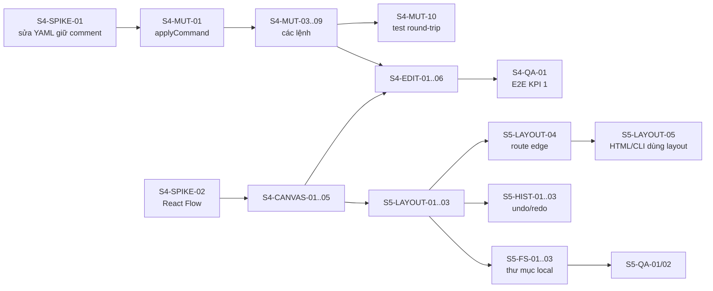

# ArchCode — Task breakdown Sprint 4–5

> Phiên bản: 0.2 · Ngày: 2026-10-10 · Trạng thái: Sprint 4 hoàn thành, Sprint 5 hoàn thành (trừ S5-TECH-03)
> Tham chiếu: [01-feature-list.md](./01-feature-list.md) · [02-architecture-and-tech-stack.md](./02-architecture-and-tech-stack.md) · [03-sprint-1-3-tasks.md](./03-sprint-1-3-tasks.md)

**Quy ước** (giữ nguyên như Sprint 1–3)
- Mỗi task ≤ 1 ngày công: S = 2h, M = 4h, L = 8h.
- `Phụ thuộc` = task phải xong trước.
- Task chỉ coi là xong khi đạt DoD và có test đi kèm (unit test cho core, E2E cho luồng người dùng).

## Bối cảnh

Sprint 1–3 đã làm xong sớm một số việc vốn dự kiến cho Sprint 5–6: IndexedDB, xuất PNG/SVG, template, rule cycle/orphan, E2E, workflow deploy. Phần MVP **còn thiếu** là trải nghiệm visual-first:

| Mã | Tính năng MVP còn thiếu | Sprint |
|---|---|---|
| VIS-02/03/04 | Kéo thả node, sửa thuộc tính, nối connector trên canvas | 4 |
| AAC-04 | Đồng bộ hai chiều **canvas → YAML**, giữ comment | 4 |
| VIS-06 | Group trên canvas | 4 (hiển thị) · 5 (kéo vào/ra) |
| AAC-12 | File layout riêng (vị trí không làm bẩn diff kiến trúc) | 5 |
| VIS-09 | Undo/redo chung cho canvas và YAML | 5 |
| GIT-01 | Mở/lưu trực tiếp thư mục repo trên máy | 5 |
| VIS-08 | Tìm kiếm và điều hướng | 5 |

**Mục tiêu sau Sprint 5:** đạt đủ 8 KPI MVP trong [01-feature-list.md §12](./01-feature-list.md). Đặc biệt là KPI 1 (tạo sơ đồ mà không viết YAML) và KPI 3 (canvas cập nhật YAML mà không mất comment).

---

## Sprint 4 — Canvas trực quan + đồng bộ Canvas → YAML

**Sprint goal:** Người dùng tạo và sửa sơ đồ hoàn toàn trên canvas. Mỗi thao tác ghi đúng vào YAML, giữ nguyên comment và phần không liên quan.

> **Trạng thái (2026-10-10): ✅ Hoàn thành 30/30 task.**
>
> Kết quả đo:
> - Sửa YAML bằng cách **vá theo range** (Document AST chỉ dùng để định vị). Document API đổi format 4/9 file ngay cả khi không sửa gì; cách vá theo range chỉ đổi đúng dòng cần sửa — xem [spikes/yaml-mutation.md](./spikes/yaml-mutation.md). Bộ test round-trip: **139 trường hợp** (mọi lệnh × 11 file) đều giữ nguyên comment.
> - **KPI 1** (E2E): từ mẫu trống, chỉ dùng canvas tạo 4 component + 3 quan hệ, sửa tên/công nghệ → YAML hợp lệ → xuất HTML.
> - **KPI 3** (E2E): thêm node, nối quan hệ, sửa thuộc tính, kéo node → mọi comment còn nguyên.
> - **KPI 8** (E2E): kéo node với 200 node / 400 connector đạt **~50 fps**. Định tuyến 400 connector mất 0,5 ms mỗi khung hình.
> - Bundle chính **322 KB gzip** (trước đó 217 KB; thêm React Flow; mục tiêu < 400 KB).
>
> Khác biệt so với kế hoạch:
> - **Group không dùng sub-flow** của React Flow. Khung group được tính từ component con, dùng chung hàm với SVG xuất ra. Kéo group thì kéo cả component bên trong. Lý do: [spikes/canvas.md](./spikes/canvas.md).
> - **Connector dùng router orthogonal của core**, dùng chung cho canvas và HTML xuất ra. Không dùng smoothstep của React Flow (vẽ khác bản xuất), cũng không dùng route ELK (phải chạy lại ~600 ms mỗi lần kéo). Ở view chưa ghim vị trí, HTML vẫn dùng route của ELK nên connector có thể khác canvas đôi chút; chế độ **Xem trước** luôn hiển thị đúng bản xuất.
> - **S4-MUT-05:** xóa component thì xóa luôn comment nằm ngay trên nó (cùng thụt lề, không cách dòng trống), vì comment đó mô tả chính component.
> - Mẫu **"Trống"** giờ chỉ có `version` + `system`, đúng kịch bản demo (trước đây có sẵn 3 component).
> - Đã làm luôn S5-LAYOUT-08 (kéo node vào/ra group) trong Sprint 4, vì dùng chung cơ chế kéo thả.

### 4.1 Spike (SPIKE) — làm đầu sprint, quyết định hướng đi cho cả sprint

| ID | Task | Ước lượng | Phụ thuộc | DoD |
|---|---|---|---|---|
| S4-SPIKE-01 | **Sửa YAML giữ comment:** đo round-trip `parseDocument → toString` trên mọi fixture/template; so sánh 2 cách sửa (Document API và CST của thư viện `yaml`); chọn chiến lược | L | — | `docs/spikes/yaml-mutation.md` có số liệu: phần trăm file round-trip không đổi byte, các trường hợp bị đổi format |
| S4-SPIKE-02 | **React Flow + layout:** node lấy vị trí từ ELK; edge kiểu smoothstep của React Flow hay route ELK; group dạng sub-flow; đo fps khi kéo với 200 node | M | — | `docs/spikes/canvas.md`, chốt cách vẽ edge và group |

### 4.2 Mutation engine trong core (MUT) — thuần hàm, chạy trong Worker

| ID | Task | Ước lượng | Phụ thuộc | DoD |
|---|---|---|---|---|
| S4-MUT-01 | Khung `applyCommand(text, command) → { text, changes }`: sửa trên YAML AST, trả text mới kèm danh sách thay đổi tối thiểu `{from, to, insert}` | L | SPIKE-01 | Editor áp dụng được `changes` mà con trỏ không nhảy |
| S4-MUT-02 | Kiểu `Command` (discriminated union) và kiểm tra tham số; lệnh không hợp lệ trả lỗi rõ ràng, không đổi text | S | MUT-01 | Test cho từng loại lỗi |
| S4-MUT-03 | `addComponent`: sinh ID duy nhất (`service`, `service-2`…), chèn cuối danh sách, theo style block/flow của phần tử lân cận | M | MUT-01 | Test với file dạng block và dạng flow |
| S4-MUT-04 | `updateField` cho component/relationship/group: đặt hoặc xóa field (xóa = bỏ key); giữ comment trên cùng dòng | M | MUT-01 | Test giữ comment cuối dòng |
| S4-MUT-05 | `deleteComponent`: xóa component cùng các quan hệ liên quan; trả danh sách tham chiếu còn sót trong views/rules để UI cảnh báo | M | MUT-01 | Test |
| S4-MUT-06 | `renameId`: đổi ID và mọi tham chiếu (`from`/`to`, `group`, `parent`, selector của view, matcher của rule) | L | MUT-01 | Đổi ID trên fixture → validate vẫn 0 lỗi |
| S4-MUT-07 | `addRelationship` / `updateRelationship` (đổi đầu nối) / `deleteRelationship` | M | MUT-01 | Test |
| S4-MUT-08 | `addGroup` / `deleteGroup` (bỏ field `group` của component con, sửa `parent` của group con) | M | MUT-01 | Test |
| S4-MUT-09 | Hỗ trợ cả `system.components` lẫn cấp gốc; tự tạo section nếu chưa có | S | MUT-03 | Test với YAML trống tối thiểu |
| S4-MUT-10 | **Bộ test round-trip:** mọi lệnh × mọi fixture/template → comment còn nguyên, phần không liên quan không đổi byte nào, kết quả validate hợp lệ | L | MUT-03..09 | Chạy trong CI |

### 4.3 Canvas (CANVAS)

| ID | Task | Ước lượng | Phụ thuộc | DoD |
|---|---|---|---|---|
| S4-CANVAS-01 | Tích hợp React Flow (`@xyflow/react`). Chế độ **Canvas** (sửa) và **Xem trước** (SVG như hiện tại, giống bản xuất), có nút chuyển | M | SPIKE-02 | E2E Sprint 3 vẫn pass ở chế độ Xem trước |
| S4-CANVAS-02 | Custom node dùng chung shape, màu và nội dung với renderer SVG: tách `shapeSvg()` và `nodeContent()` thành export chung của core | L | CANVAS-01 | Node trên canvas và trong HTML xuất trông giống nhau (so ảnh chụp) |
| S4-CANVAS-03 | Edge: mũi tên, nhãn `label` + `[type]`, nét đứt cho quan hệ bất đồng bộ, viền đỏ/cam khi có lỗi | M | CANVAS-01 | — |
| S4-CANVAS-04 | Group dạng sub-flow, hỗ trợ group lồng nhau | M | CANVAS-02 | Hiển thị đúng fixture có group `data` lồng trong `core` |
| S4-CANVAS-05 | Vị trí ban đầu lấy từ ELK (trong Worker). Khi model đổi, node đã có giữ nguyên chỗ, chỉ node mới được đặt | M | CANVAS-02 | Gõ YAML không làm diagram "nhảy" |
| S4-CANVAS-06 | Zoom/pan, minimap, snap-to-grid, fit view; tô viền theo diagnostics | S | CANVAS-02 | — |
| S4-CANVAS-07 | Đồng bộ chọn hai chiều: chọn node ↔ con trỏ YAML (đặt con trỏ trong block của component → node được chọn) | M | CANVAS-02 | E2E |

### 4.4 Thao tác tạo/sửa (EDIT)

| ID | Task | Ước lượng | Phụ thuộc | DoD |
|---|---|---|---|---|
| S4-EDIT-01 | Palette 10 loại component; kéo thả vào canvas → `addComponent` tại vị trí thả | M | MUT-03, CANVAS-02 | — |
| S4-EDIT-02 | Kéo từ handle của node này sang node khác → `addRelationship`; type gợi ý theo đích (database → `sql`, queue → `amqp`) | M | MUT-07, CANVAS-03 | — |
| S4-EDIT-03 | Property panel cho component: id (đổi tên), name, type, technology, description, owner, group, tags; hiện lỗi của chính phần tử đó | L | MUT-04, MUT-06 | Sửa field → YAML cập nhật ngay |
| S4-EDIT-04 | Property panel cho relationship và group | M | EDIT-03, MUT-08 | — |
| S4-EDIT-05 | Xóa bằng phím Delete hoặc nút; hỏi xác nhận khi phần tử còn được tham chiếu trong views/rules | S | MUT-05 | — |
| S4-EDIT-06 | Luồng áp dụng lệnh: Worker chạy `applyCommand` → `changes` → transaction CodeMirror (giữ con trỏ và vị trí cuộn) → phân tích lại | M | MUT-01 | Một thao tác canvas = một transaction |
| S4-EDIT-07 | Khi YAML lỗi cú pháp: canvas chuyển sang chỉ đọc kèm thông báo (không sửa trên bản cũ) | S | EDIT-06 | E2E |

### 4.5 Kiểm thử (QA)

| ID | Task | Ước lượng | Phụ thuộc | DoD |
|---|---|---|---|---|
| S4-QA-01 | **E2E KPI 1:** từ mẫu trống, chỉ dùng canvas, tạo 4 component + 3 quan hệ → YAML hợp lệ → xuất HTML | M | EDIT-01..03 | Không có bước gõ YAML nào |
| S4-QA-02 | **E2E KPI 3:** thao tác trên canvas không làm mất comment trong YAML | S | EDIT-06 | — |
| S4-QA-03 | E2E: đổi ID qua property panel → mọi tham chiếu cập nhật, 0 lỗi | S | EDIT-03 | — |
| S4-QA-04 | Hiệu năng canvas: 200 node, kéo giữ ≥ 30 fps (đo bằng Performance API trong Playwright) | M | CANVAS-05 | Đạt KPI 8 |

**Demo cuối Sprint 4:** chọn mẫu trống → kéo 4 component từ palette → nối 3 quan hệ → sửa tên và công nghệ trong property panel → YAML bên trái cập nhật theo từng thao tác, comment còn nguyên → xuất HTML.

---

## Sprint 5 — File layout, Undo/Redo, Thư mục local, Tìm kiếm

**Sprint goal:** Vị trí kéo thả được lưu mà không làm bẩn diff kiến trúc; undo/redo thống nhất; sửa trực tiếp file trong repo đã clone.

> **Trạng thái (2026-10-10): ✅ Hoàn thành 24/25 task.** S5-TECH-03 chưa làm vì repo chưa có remote. Toàn dự án: unit test **318** (core 299, CLI 16, web 3) + E2E **35** (Playwright trên bản build production).
>
> Kết quả đo:
> - Kéo node: file YAML **không đổi byte nào**, vị trí nằm trong `<tên>.layout.yaml`. E2E kiểm chứng: lưu vào thư mục → `git diff` của YAML chỉ có các dòng đổi tên; HTML xuất từ web có layout **giống hệt từng byte** output của CLI với cùng YAML + file layout.
> - Layout thủ công 200 node: 2,5 ms khi mọi node đã ghim, 9 ms khi có 50 node mới cần tự đặt (ELK mất ~600 ms).
> - Validate 200 component / 400 quan hệ: **~28 ms** khi đo riêng, trong đó parse YAML chiếm ~80% (mục tiêu < 50 ms).
>
> Khác biệt so với kế hoạch:
> - **S5-LAYOUT-02:** ELK không ghim được một phần node, nên node mới được đặt vào ô trống gần nhất cạnh node cùng group hoặc node có quan hệ với nó; không có điểm neo thì xếp vào vùng trống bên phải. Lần kéo đầu tiên trong một view ghim mọi node của view, để HTML xuất ra khớp với canvas.
> - **S5-LAYOUT-04:** chọn router orthogonal đơn giản. Hỗ trợ điểm gấp (`edges.<id>.points`) khi đọc file layout; canvas chưa có thao tác sửa điểm gấp.
> - **S5-HIST-01:** mục lịch sử còn lưu cả vị trí tạm trong phiên (ngoài YAML, layout, selection), để undo một lần kéo đưa node về đúng chỗ cũ.
> - **S5-FS-03:** file đổi bên ngoài khi *không có* thay đổi chưa lưu thì tự nạp lại và báo; chỉ hỏi khi đang có thay đổi chưa lưu. Trước khi ghi đè, ứng dụng cũng kiểm tra file trên đĩa có bị đổi không.
> - **S5-QA-02:** E2E dùng Origin Private File System làm "thư mục tạm", vì Playwright không điều khiển được hộp chọn thư mục của hệ điều hành. Handle OPFS có cùng API đọc/ghi/liệt kê với thư mục thật.
> - **S5-TECH-02:** cache `groupChain` theo model. Test hiệu năng (unit và E2E fps) chạy riêng sau các test khác để số đo không bị nhiễu khi chạy song song.
> - **S5-TECH-03:** ⏸ chưa làm — repo chưa có remote. Workflow CI/Pages đã sẵn; job E2E giờ có thêm project `perf`.

### 5.1 Presentation model (LAYOUT) — AAC-12

| ID | Task | Ước lượng | Phụ thuộc | DoD |
|---|---|---|---|---|
| S5-LAYOUT-01 | Schema, parser và validate cho `architecture.layout.yaml` (`views.<id>.nodes.<id>: {x, y}`, waypoint tùy chọn); ID không tồn tại → cảnh báo | M | — | Đúng định dạng §4.3 tài liệu kiến trúc |
| S5-LAYOUT-02 | Layout có ghim: node có vị trí giữ nguyên, node mới được ELK đặt quanh (theo kết quả S4-SPIKE-02; phương án dự phòng: đặt vào vùng trống bên phải) | L | LAYOUT-01 | Không chồng node |
| S5-LAYOUT-03 | Kéo node trên canvas → ghi vị trí vào layout model theo view, không đụng YAML semantic | S | LAYOUT-01 | YAML không đổi byte nào khi kéo |
| S5-LAYOUT-04 | Route edge cho layout thủ công khi render SVG/HTML (ELK với vị trí cố định, hoặc router orthogonal đơn giản) | L | LAYOUT-02 | HTML xuất khớp với canvas |
| S5-LAYOUT-05 | `generateHtml`/`renderSvg` nhận layout; CLI `build` tự đọc `<tên>.layout.yaml` cạnh file YAML, thêm `--layout <path>` và `--auto-layout` | M | LAYOUT-04 | Web và CLI vẫn cho HTML giống hệt nhau |
| S5-LAYOUT-06 | Giữ layout nhất quán: `renameId` đổi key trong layout; khi lưu, dọn entry của phần tử đã xóa | S | LAYOUT-01, S4-MUT-06 | Test |
| S5-LAYOUT-07 | Nút "Sắp xếp lại": bỏ ghim cả view hoặc chỉ các node đang chọn | S | LAYOUT-02 | — |
| S5-LAYOUT-08 | Kéo node vào/ra group trên canvas → lệnh `updateField group` | M | S4-CANVAS-04 | E2E |

### 5.2 Undo/Redo (HIST) — VIS-09

| ID | Task | Ước lượng | Phụ thuộc | DoD |
|---|---|---|---|---|
| S5-HIST-01 | Lịch sử chung trong store: mỗi mục = `{yaml, layout, selection}`; một thao tác canvas = một mục; gõ YAML được gộp theo khoảng nghỉ 500ms; tắt history riêng của CodeMirror | L | LAYOUT-03 | — |
| S5-HIST-02 | Ctrl+Z / Ctrl+Shift+Z / Ctrl+Y dùng được ở mọi nơi (editor, canvas); nút trên toolbar; giới hạn 200 mục | S | HIST-01 | — |
| S5-HIST-03 | Undo khôi phục con trỏ/selection hợp lý; E2E chuỗi thao tác xen kẽ canvas và YAML | M | HIST-02 | E2E |

### 5.3 Thư mục local (FS) — GIT-01

| ID | Task | Ước lượng | Phụ thuộc | DoD |
|---|---|---|---|---|
| S5-FS-01 | Mở thư mục bằng File System Access API: liệt kê file kiến trúc (`*.yaml` có `version` và `system`), chọn để mở | M | — | Chrome/Edge |
| S5-FS-02 | Lưu (Ctrl+S) ghi thẳng file YAML và file layout; hiện trạng thái "chưa lưu" | M | FS-01, LAYOUT-01 | — |
| S5-FS-03 | Phát hiện file bị đổi bên ngoài (git pull, editor khác) khi quay lại tab → hỏi nạp lại hay giữ bản đang sửa | M | FS-02 | — |
| S5-FS-04 | Nhớ thư mục gần đây (lưu handle trong IndexedDB, xin lại quyền khi mở) | S | FS-01 | — |
| S5-FS-05 | Fallback cho Firefox/Safari: tải lên/tải về cả hai file, thông báo rõ hạn chế | S | FS-02 | — |
| S5-FS-06 | Autosave IndexedDB lưu cả layout | S | LAYOUT-01 | Tải lại trang giữ vị trí node |

### 5.4 Tìm kiếm và điều hướng (NAV) — VIS-08

| ID | Task | Ước lượng | Phụ thuộc | DoD |
|---|---|---|---|---|
| S5-NAV-01 | Ô tìm kiếm Ctrl+K: tìm component/group theo id, tên, công nghệ, owner | M | — | — |
| S5-NAV-02 | Chọn kết quả → chọn và căn giữa node trên canvas, nhảy tới YAML; nếu node không có trong view hiện tại → chuyển sang view chứa nó | S | NAV-01 | E2E |

### 5.5 Nợ kỹ thuật (TECH) — từ phát hiện ở Sprint 2–3

| ID | Task | Ước lượng | Phụ thuộc | DoD |
|---|---|---|---|---|
| S5-TECH-01 | Rule `no-circular` thêm tùy chọn `ignore: async` để bỏ qua quan hệ bất đồng bộ (event bus hai chiều) | S | — | Test |
| S5-TECH-02 | Đưa validate 200 component về < 50ms (hiện 54ms): profile, cache `groupChain`/`resolveView` | S | — | Test hiệu năng |
| S5-TECH-03 | Chạy CI và deploy Pages thật khi có remote; sửa lỗi môi trường CI nếu có | S | — | CI xanh, có URL Pages |

### 5.6 Kiểm thử và tài liệu (QA)

| ID | Task | Ước lượng | Phụ thuộc | DoD |
|---|---|---|---|---|
| S5-QA-01 | E2E: kéo node → lưu → mở lại → vị trí giữ nguyên, YAML semantic không đổi byte nào | S | FS-06 | — |
| S5-QA-02 | E2E File System Access (Chromium) với thư mục tạm | M | FS-03 | — |
| S5-QA-03 | Cập nhật README, tài liệu cú pháp file layout, quy ước commit file layout vào Git | S | — | — |

**Demo cuối Sprint 5:** mở thư mục repo → chọn `architecture.yaml` → kéo sắp xếp lại vài node, đổi tên một service → Ctrl+Z / Ctrl+Shift+Z qua lại → Ctrl+S → `git diff` cho thấy file YAML chỉ đổi đúng phần đổi tên, vị trí nằm riêng trong `architecture.layout.yaml`.

---

## Tổng hợp khối lượng

| Sprint | Số task | Ước lượng (giờ) | Rủi ro chính |
|---|---|---|---|
| Sprint 4 | 30 | ~130h | Sửa YAML giữ comment (S4-MUT-*); có S4-SPIKE-01 ở đầu sprint để quyết định sớm |
| Sprint 5 | 25 | ~86h | Route edge cho layout thủ công (S5-LAYOUT-04) |

**Sprint 4 đang quá tải rõ rệt.** 1 developer có khoảng 60–64h hiệu dụng mỗi sprint 2 tuần, nên Sprint 4 cần khoảng 2 người, Sprint 5 khoảng 1,4 người. Gợi ý:

- **Phương án A (khuyến nghị) — chuyển một phần Sprint 4 sang Sprint 5:** dời S4-CANVAS-07, S4-EDIT-04, S4-EDIT-07, S4-QA-03, S4-QA-04 (~16h) sang Sprint 5. Khi đó Sprint 4 còn ~114h, Sprint 5 lên ~102h, cân bằng ở mức 2 người mỗi sprint.
- **Phương án B — 1 developer:** giãn thành 4 sprint (4a: spike + mutation; 4b: canvas + edit; 5a: layout + undo; 5b: thư mục local + tìm kiếm + nợ kỹ thuật).
- **Có thể dời hẳn sang V1 nếu cần cắt phạm vi:** S5-FS-03, S5-FS-04, S5-LAYOUT-07, S5-LAYOUT-08, S5-NAV-* (~18h). MVP vẫn đạt đủ KPI.

## Đường găng (critical path)

Làm song song được với đường găng: S4-SPIKE-02 song song S4-SPIKE-01; nhóm S4-CANVAS-* song song nhóm S4-MUT-*; S5-NAV-* và S5-TECH-* làm bất cứ lúc nào.

## Quyết định cần chốt trong Sprint 4

1. **Chiến lược sửa YAML** (S4-SPIKE-01): sửa qua Document API (đơn giản, có thể đổi format một số dòng) hay qua CST (giữ nguyên từng byte, phức tạp hơn).
2. **Cách vẽ edge trên canvas** (S4-SPIKE-02): edge của React Flow (nhanh, mượt khi kéo, nhưng khác route của ELK trong HTML xuất) hay dùng route ELK (giống bản xuất, nhưng phải tính lại khi kéo).
3. **Canvas thay thế hay song song với Xem trước SVG:** đề xuất giữ cả hai. Canvas để sửa; Xem trước để xem chính xác bản sẽ xuất ra HTML.
