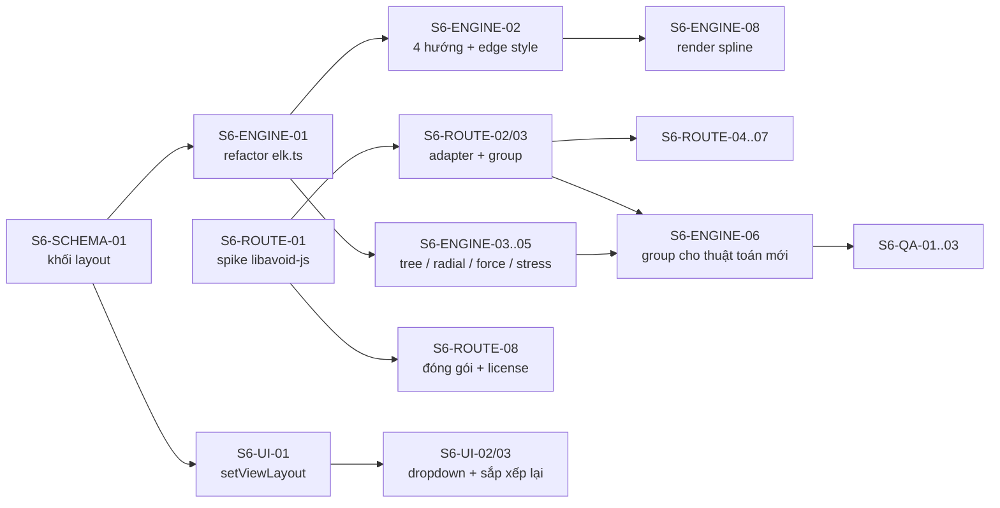

# ArchCode — Task breakdown Sprint 6: Thuật toán layout

> Phiên bản: 0.1 · Ngày: 2026-10-17 · Trạng thái: Kế hoạch (đã chốt 3 quyết định)
> Tham chiếu: [02-architecture-and-tech-stack.md](./02-architecture-and-tech-stack.md) · [04-sprint-4-5-tasks.md](./04-sprint-4-5-tasks.md) · [spikes/elk.md](./spikes/elk.md)

**Quy ước** (giữ nguyên như Sprint 1–5)
- Mỗi task ≤ 1 ngày công: S = 2h, M = 4h, L = 8h.
- `Phụ thuộc` = task phải xong trước.
- Task chỉ coi là xong khi đạt DoD và có test đi kèm (unit test cho core, E2E cho luồng người dùng).

## Bối cảnh

Rà soát các thuật toán layout phổ biến so với hiện trạng:

| Thuật toán | Hiện trạng | Hướng xử lý |
|---|---|---|
| Sugiyama / ELK Layered | ✅ Engine mặc định ([layout/elk.ts](../packages/core/src/layout/elk.ts)) | Giữ nguyên, mở thêm option |
| Orthogonal routing | ⚠️ Auto-layout dùng ELK `ORTHOGONAL`. Layout thủ công dùng router tự viết, **không tránh node** ([layout/route.ts](../packages/core/src/layout/route.ts)) | Thay bằng libavoid-js (nhóm ROUTE) |
| Tree / Radial | ❌ Chưa có (riêng mindmap có layout cây tự viết) | Dùng `mrtree`, `radial` của elkjs |
| Force-Directed / Stress | ❌ Chưa có | Dùng `force`, `stress` của elkjs + `sporeOverlap` |
| Grid / Packing | ❌ Chưa có | Dùng `rectpacking` của elkjs |
| Dagre | ❌ Cố ý bỏ ([spikes/elk.md](./spikes/elk.md), quyết định 4) | **Không làm** |

elkjs 0.12 đang cài đã có sẵn: `layered`, `mrtree`, `radial`, `stress`, `force`, `rectpacking`, `box`, `sporeOverlap`, `sporeCompaction`, `fixed`, `random`. **Không cần thêm dependency cho layout.** Riêng routing thêm `libavoid-js` (WASM).

**Mục tiêu sau Sprint 6:**
1. Mỗi view chọn được thuật toán, hướng (4 hướng) và kiểu connector.
2. Connector ở layout thủ công không cắt ngang node.
3. Mọi thuật toán đều deterministic: cùng input → cùng tọa độ.

**Tiến độ (2026-10-17):** ✅ xong · 🟡 làm một phần — SCHEMA-03: mới có `layout-option-conflict` (mã kebab-case như các mã khác); SCHEMA-04: autocomplete xong, chưa có lint riêng; ENGINE-02: 4 hướng xong, `edges` mới đọc vào model; ROUTE-07: libavoid dùng cho layout thủ công ở preview/xuất/CLI, ngưỡng `MAX_AVOID_EDGES = 100` connector mỗi router, canvas khi kéo vẫn dùng router cũ; WASM nạp lười ở lần layout thủ công đầu tiên (web: URL có hash qua `setRouterWasmUrl`); ROUTE-08: WASM tách file ở web và CLI (`dist/libavoid.wasm` + `LICENSE.libavoid`), Hugo viewer dùng stub — còn thiếu `THIRD_PARTY_LICENSES` và publish dry-run.

**Cú pháp đích** (vẫn nhận `direction` ở cấp view cho tương thích ngược):

```yaml
views:
  - id: overview
    layout:
      algorithm: layered   # layered | tree | radial | stress | force | grid
      direction: LR        # TB | LR | BT | RL
      edges: orthogonal    # orthogonal | polyline | splines
```

---

### 6.1 Schema & model (SCHEMA)

| ID | Task | Ước lượng | Phụ thuộc | DoD |
|---|---|---|---|---|
| S6-SCHEMA-01 ✅ | Thêm khối `layout` (`algorithm`, `direction`, `edges`) cho view vào `architecture.schema.json` và `types.ts`; `direction` thêm `BT`, `RL` | M | — | Test schema: giá trị hợp lệ/không hợp lệ |
| S6-SCHEMA-02 ✅ | Normalize: `view.direction` cũ → `view.layout.direction`; khai báo cả hai thì báo lỗi xung đột | S | SCHEMA-01 | Test normalize; fixture cũ validate 0 lỗi |
| S6-SCHEMA-03 🟡 | Mã lỗi/cảnh báo mới trong `codes.ts`: `layout-not-tree`, `layout-option-conflict`, `layout-algorithm-ignores-groups` | S | SCHEMA-01 | Test semantic cho từng mã |
| S6-SCHEMA-04 🟡 | Autocomplete và lint cho khối `layout` trong YAML editor | S | SCHEMA-01 | Gõ `algorithm:` → gợi ý 6 giá trị |

### 6.2 Engine layout (ENGINE)

| ID | Task | Ước lượng | Phụ thuộc | DoD |
|---|---|---|---|---|
| S6-ENGINE-01 | Refactor `elk.ts`: tách `layoutOptions` thành map `algorithm → buildOptions(view)`; phần chuyển tọa độ tuyệt đối giữ chung | M | SCHEMA-01 | Snapshot `layout.test.ts` hiện tại **không đổi** |
| S6-ENGINE-02 🟡 | `direction` 4 hướng (`DOWN/UP/RIGHT/LEFT`) và `edges` (`ORTHOGONAL/POLYLINE/SPLINES`) cho `layered` | S | ENGINE-01 | Snapshot mỗi tổ hợp trên 1 fixture |
| S6-ENGINE-03 | `tree` (mrtree): graph không phải cây → lấy cây khung theo thứ tự khai báo, cạnh dư định tuyến bằng `routeEdges()`, cảnh báo `layout-not-tree` | L | ENGINE-01, SCHEMA-03 | Test cây thuần + graph có chu trình |
| S6-ENGINE-04 | `radial` + chọn root cho `tree`/`radial`: mặc định là node **có nhiều liên kết nhất** (bằng nhau → node khai báo trước); `layout.root` để ghi đè. Dùng chung xử lý cây khung với ENGINE-03 | M | ENGINE-03 | Test chọn root: bậc cao nhất, hòa, có `layout.root` |
| S6-ENGINE-05 | `stress` và `force`: cố định `elk.randomSeed`, số vòng lặp; chạy `sporeOverlap` sau đó để gỡ chồng lấn | M | ENGINE-01 | Chạy 2 lần → JSON giống hệt; không có 2 node chồng nhau |
| S6-ENGINE-06 | Group cho các thuật toán không hỗ trợ `INCLUDE_CHILDREN` (tree/radial/stress/force): layout từng group (`SEPARATE_CHILDREN`) → layout lớp ngoài → cạnh xuyên group đi qua `routeEdges()` | L | ENGINE-05, ROUTE-03 | Fixture group lồng 2 cấp: không cạnh nào thiếu, group bao đủ con |
| S6-ENGINE-07 | `grid` (rectpacking): dùng cho view ít cạnh; cạnh (nếu có) định tuyến bằng `routeEdges()` | S | ENGINE-01 | Snapshot |
| S6-ENGINE-08 | Render spline: bendPoints của ELK `SPLINES` → path cubic Bézier (`C`) trong `render/svg.ts`; nhãn đặt đúng giữa đường cong | M | ENGINE-02 | Test render; HTML xuất hiển thị đúng |

### 6.3 Router orthogonal tránh vật cản (ROUTE) — libavoid-js, cho layout thủ công

> Đã chốt dùng [libavoid-js](https://github.com/Aksem/libavoid-js) (WASM của libavoid/Adaptagrams). Lưu ý: **LGPL-2.1-or-later** và đang ở bản **0.5.0-beta**. ArchCode là MIT, nên WASM phải là file riêng, nạp lúc chạy (không gộp vào bundle JS), và phải kèm license notice — xem ROUTE-01, ROUTE-08.

| ID | Task | Ước lượng | Phụ thuộc | DoD |
|---|---|---|---|---|
| S6-ROUTE-01 ✅ | **Spike tích hợp libavoid-js:** nạp WASM ở browser (main thread + Worker) và Node (CLI); đo kích thước (gzip), thời gian route 50/200 node, thời gian `moveShape` khi kéo; xác nhận cách đóng gói đúng LGPL | M | — | `docs/spikes/libavoid.md` có số liệu và kết luận về license |
| S6-ROUTE-02 ✅ | Adapter `layout/avoid.ts`: `loadRouter()` khởi tạo async một lần; chuyển `Box`/`RouteRequest` → `ShapeRef`/`ConnRef` (orthogonal, `shapeBufferDistance`, `idealNudgingDistance`) → `RouteResult`; giữ nguyên chữ ký `routeEdges()` | L | ROUTE-01 | Unit test: không đoạn nào đi xuyên node không phải đầu mút |
| S6-ROUTE-03 ✅ | Group: khung group là vật cản với cạnh từ ngoài vào; cạnh nối tới node bên trong được phép đi xuyên khung group chứa nó | L | ROUTE-02 | Fixture group lồng 2 cấp: connector không cắt group không liên quan |
| S6-ROUTE-04 ✅ | Waypoint người dùng khai báo → `ConnRef.setRoutingCheckpoints` | M | ROUTE-02 | `manual-layout.test.ts` cũ vẫn pass + test mới |
| S6-ROUTE-05 | Tách cạnh song song (nudging, khoảng cách 8px) và đặt nhãn giữa route | S | ROUTE-02 | Test 3 cạnh song song có khoảng cách ≥ 8px |
| S6-ROUTE-06 | ⚠️ Rủi ro R-ROUTE-PERF. Canvas route tăng dần: giữ một `Router` sống ở main thread; kéo node → `moveShape` + `processTransaction`; chỉ cập nhật cạnh có thay đổi | M | ROUTE-02 | Perf: 200 node / 400 connector, kéo node ≥ 50 fps (giữ KPI 8) |
| S6-ROUTE-07 ✅ | Fallback: WASM chưa nạp xong hoặc lỗi → dùng router cũ (chữ Z); xuất SVG/CLI thì `await loadRouter()`; HTML xuất ra chứa route tính sẵn, không cần WASM | M | ROUTE-02 | Test nạp lỗi; HTML xuất mở offline đúng |
| S6-ROUTE-08 🟡 | Đóng gói và license: WASM là asset riêng (Vite `?url`; CLI resolve từ `node_modules`), thêm `THIRD_PARTY_LICENSES`, cập nhật `write-publish-package.mjs` | S | ROUTE-01 | `pnpm build` + publish dry-run có file WASM và notice |

### 6.4 Web UI (UI)

| ID | Task | Ước lượng | Phụ thuộc | DoD |
|---|---|---|---|---|
| S6-UI-01 | Lệnh mutation `setViewLayout(viewId, { algorithm?, direction?, edges? })`: ghi vào YAML, giữ comment | M | SCHEMA-01 | Thêm vào bộ test round-trip `mutate-roundtrip.test.ts` |
| S6-UI-02 | Dropdown Algorithm / Direction / Edge style trong `Appearance.tsx`; đổi giá trị → ghi YAML, preview cập nhật. View đã ghim vị trí: **node không di chuyển**, chỉ hiện gợi ý bấm "Sắp xếp lại" | M | UI-01, ENGINE-01 | E2E cho cả view chưa ghim và đã ghim |
| S6-UI-03 | Nút **"Sắp xếp lại"**: cách duy nhất để thuật toán mới áp dụng lên view đã ghim; chạy thuật toán đang chọn, ghi đè vị trí và xóa waypoint cũ trong file layout (1 mục undo) | M | UI-02 | E2E: bấm → undo → về vị trí cũ |
| S6-UI-04 | Canvas vẽ được spline (`EdgeView.tsx`) khi `edges: splines` ở view chưa ghim | S | ENGINE-08 | Canvas và Xem trước giống nhau |
| S6-UI-05 | Cảnh báo trên UI khi `force`/`stress` chạy trên view > 150 node (gợi ý tách view hoặc dùng `layered`) | S | ENGINE-05 | E2E với fixture lớn |

### 6.5 Kiểm thử và tài liệu (QA)

| ID | Task | Ước lượng | Phụ thuộc | DoD |
|---|---|---|---|---|
| S6-QA-01 | Test deterministic cho mọi thuật toán (chạy 2 lần, so JSON) | S | ENGINE-03..07 | Chạy trong CI |
| S6-QA-02 | Benchmark trong `perf.test.ts`: mỗi thuật toán với 50 node và 200 node / 400 edge; cập nhật bảng số liệu trong `spikes/elk.md` | M | ENGINE-05 | 200 node ≤ 1s với `layered`; ghi lại số của `force`/`stress` |
| S6-QA-03 | Fixture mẫu cho từng thuật toán (`fixtures/layout-*.yaml`) + snapshot SVG | M | ENGINE-* | Snapshot ổn định |
| S6-QA-04 | Cập nhật [05-syntax-guide.md](./05-syntax-guide.md): khối `layout`, gợi ý chọn thuật toán theo loại sơ đồ | S | SCHEMA-01 | Review |
| S6-QA-05 | Template mới: "Knowledge graph" (stress) và "Org chart" (tree) | S | ENGINE-03, ENGINE-05 | Hiện trong danh sách template |

---

## Tổng hợp khối lượng

| Nhóm | Số task | Ước lượng (giờ) |
|---|---|---|
| SCHEMA | 4 | 10h |
| ENGINE | 8 | 36h |
| ROUTE | 8 | 36h |
| UI | 5 | 16h |
| QA | 5 | 14h |
| **Tổng** | **30** | **~112h** |

1 developer có khoảng 60–64h hiệu dụng mỗi sprint 2 tuần, nên **Sprint 6 cần 2 người**, hoặc giãn thành 2 sprint:

- **6a (giá trị cao, rủi ro thấp):** SCHEMA-*, ENGINE-01/02/08, ROUTE-*, UI-01/02/04, QA-04 (~68h).
- **6b (thuật toán mới):** ENGINE-03..07, UI-03/05, QA-01/02/03/05 (~44h).
- **Có thể cắt nếu thiếu thời gian:** ENGINE-04 phần `radial` (giữ phần chọn root vì `tree` cần), ENGINE-07 (grid), ROUTE-05 (nudging), QA-05 (~10h).

## Đường găng (critical path)



Làm song song được: nhóm ROUTE-* độc lập hoàn toàn với SCHEMA/ENGINE và có thể bắt đầu ngay ngày đầu; UI-01 song song ENGINE-01.

## Quyết định đã chốt (2026-10-17)

1. **Router: dùng `libavoid-js`** — giữ nguyên kế hoạch sau spike (S6-ROUTE-01). Hiệu năng khi kéo node chưa đạt KPI 8, đã ghi vào bảng rủi ro: **R-ROUTE-PERF** ([02-architecture-and-tech-stack.md §11](./02-architecture-and-tech-stack.md#11-rủi-ro-kỹ-thuật--giảm-thiểu)). Rủi ro cần theo dõi: license LGPL-2.1 (giải quyết bằng cách tách WASM thành file riêng + notice, xem ROUTE-08) và thư viện còn ở bản beta (ghim đúng phiên bản, giữ router cũ làm fallback, xem ROUTE-07).
2. **Root mặc định cho `tree`/`radial`:** node có nhiều liên kết nhất; bằng nhau thì lấy node khai báo trước; ghi đè bằng `layout.root`.
3. **Đổi thuật toán ở view đã ghim vị trí:** giữ nguyên vị trí ghim. Thuật toán mới chỉ áp dụng khi bấm **"Sắp xếp lại"**.
