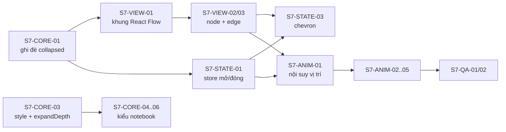

# ArchCode — Task breakdown Sprint 7: Mind map tương tác (kiểu NotebookLM)

> Phiên bản: 0.1 · Ngày: 2026-10-18 · Trạng thái: Kế hoạch
> Tham chiếu: [02-architecture-and-tech-stack.md](./02-architecture-and-tech-stack.md) · [06-design-tokens.md](./06-design-tokens.md) · [07-layout-algorithms-tasks.md](./07-layout-algorithms-tasks.md)

**Quy ước** (giữ nguyên như Sprint 1–6)
- Mỗi task ≤ 1 ngày công: S = 2h, M = 4h, L = 8h.
- `Phụ thuộc` = task phải xong trước.
- Task chỉ coi là xong khi đạt DoD và có test đi kèm (unit test cho core, E2E cho luồng người dùng).

## Bối cảnh

Mục tiêu là trải nghiệm giống mind map của NotebookLM: cây mọc một phía, node dạng viên bo tròn, bấm chevron để mở/đóng nhánh có chuyển động mượt, kéo/zoom tự do. **Chỉ làm giao diện: không có LLM, không có server.** Nội dung mind map vẫn là file YAML `kind: mindmap` như hiện tại.

| Hạng mục | Hiện trạng | Hướng xử lý |
|---|---|---|
| Layout cây | ✅ [mindmap/layout.ts](../packages/core/src/mindmap/layout.ts), có `direction: LR` | Giữ nguyên, thêm tham số ghi đè `collapsed` |
| Vẽ | ⚠️ Chuỗi SVG ([mindmap/render.ts](../packages/core/src/mindmap/render.ts)) gán vào Preview, mỗi lần vẽ lại thay cả SVG | Preview dùng **React Flow** (`@xyflow/react`, đã có trong dự án). Chuỗi SVG giữ cho CLI và xuất file |
| Mở/đóng nhánh | ⚠️ Chỉ khai báo `collapsed` trong YAML, hiện huy hiệu `+N` | Trạng thái giao diện riêng, bấm chevron, không sửa YAML |
| Chuyển động | ❌ | Nội suy vị trí bằng `requestAnimationFrame` |
| Kéo/zoom, click → nhảy tới YAML | ✅ trong [Preview.tsx](../apps/web/src/preview/Preview.tsx) | Chuyển sang React Flow |
| Xuất SVG/PNG | ✅ qua worker ([files.ts](../apps/web/src/files/files.ts) `svgToPng`) | Xuất đúng trạng thái mở/đóng đang xem |
| Tìm kiếm | ❌ Nút "Tìm" bị tắt với mind map | Bật lên, tự mở nhánh tới kết quả |

**Nguyên tắc:** core tính layout, React Flow chỉ hiển thị. Layout giữ deterministic (cùng model và cùng trạng thái mở/đóng → cùng tọa độ), nên Preview, SVG xuất ra và CLI luôn khớp nhau.

**Mục tiêu sau Sprint 7:**
1. Bấm chevron mở/đóng nhánh, có chuyển động, node vừa bấm đứng yên trên màn hình.
2. Kiểu hiển thị `style: notebook` giống NotebookLM, dùng được cả ở Preview và file xuất.
3. Mở/đóng 300 node vẫn đạt ≥ 50 fps.

**Tiến độ (2026-10-18):** ✅ xong · 🟡 làm một phần.
- Preview mind map chạy trên React Flow ([mindmap/MindmapFlow.tsx](../apps/web/src/mindmap/MindmapFlow.tsx)). Node vẽ bằng chính `mindNodeBodySvg` của core nên giống hệt SVG xuất ra.
- ANIM-03: không dịch viewport mà dịch cả layout mới để node neo trùng vị trí cũ. Kết quả như nhau, và không phải đồng bộ camera với chuyển động.
- CORE-03: mind map không có JSON schema (validate viết tay trong `mindmap/validate.ts`), nên chỉ thêm vào validate + autocomplete riêng ([editor/mindmapCompletion.ts](../apps/web/src/editor/mindmapCompletion.ts)). Danh sách trường dùng chung `MIND_ROOT_FIELDS`/`MIND_NODE_FIELDS`/`MIND_LINK_FIELDS`.
- ANIM-05 🟡: khung giữa ghi thẳng transform/path vào DOM (React chỉ render frame đầu và cuối). Đo 300 node: 49–55 fps, khung chậm nhất 67–100 ms là lần React gắn/gỡ ~300 node. Test perf dùng ngưỡng 45 fps để CI không chập chờn; muốn chắc ≥ 50 cần giảm chi phí gắn node (vd. `onlyRenderVisibleElements` khi zoom gần, hoặc gắn node mới rải qua vài frame).
- QA-02 🟡: cây 301 node sinh ngay trong `e2e/perf.spec.ts` thay cho file fixture; chưa ghi số liệu vào docs khác.
- VIEW-05 🟡: đã sửa một ca tràn chữ (nhánh chính notebook in đậm nhưng layout đo chữ thường). Chưa đo trên Firefox/Safari.

**Cú pháp đích:**

```yaml
version: 1
kind: mindmap
style: notebook      # classic (mặc định, như hiện tại) | notebook
direction: LR        # notebook mặc định LR
expandDepth: 1       # số tầng mở sẵn khi mở file; node có `collapsed` vẫn được tôn trọng
root:
  text: Chủ đề chính
  children: [...]
```

---

### 7.1 Core (CORE)

| ID | Task | Ước lượng | Phụ thuộc | DoD |
|---|---|---|---|---|
| S7-CORE-01 ✅ | `layoutMindmap(model, { collapsed?: (node) => boolean })`: ghi đè cờ `collapsed` khi tính layout. Không truyền → giữ hành vi cũ | S | — | Snapshot `mindmap.test.ts` hiện tại **không đổi**; test ghi đè mở/đóng |
| S7-CORE-02 ✅ | `MindBox` thêm `childCount` (số con trực tiếp, tính cả con đang ẩn) cho chevron | S | — | Unit test |
| S7-CORE-03 ✅ | Thêm `style` (`classic` \| `notebook`) và `expandDepth` vào `types.ts`, `validate.ts`, JSON schema; autocomplete trong editor | M | — | Test validate: giá trị hợp lệ/không hợp lệ; gõ `style:` → gợi ý 2 giá trị |
| S7-CORE-04 ✅ | Layout `notebook`: mọi tầng là viên bo tròn (không dùng kiểu gạch chân ở tầng 2+), neo nhánh ở giữa mép node, bảng `LEVELS` riêng; mặc định `direction: LR` | M | CORE-03 | Snapshot fixture mới `fixtures/mindmap-notebook.yaml` |
| S7-CORE-05 ✅ | `render.ts` vẽ được `style: notebook`, để SVG/PNG xuất ra giống Preview | M | CORE-04 | Snapshot SVG |
| S7-CORE-06 ✅ | Màu theo tầng cho `notebook` trong [mindmap/theme.ts](../packages/core/src/mindmap/theme.ts), dùng design tokens (sáng/tối) | S | CORE-04 | Kiểm tra tương phản theo [06-design-tokens.md](./06-design-tokens.md) |

### 7.2 Hiển thị bằng React Flow (VIEW)

| ID | Task | Ước lượng | Phụ thuộc | DoD |
|---|---|---|---|---|
| S7-VIEW-01 ✅ | Khung `apps/web/src/preview/MindmapFlow.tsx`: `MindmapLayout` → `nodes`/`edges`; `nodesDraggable={false}`, `nodesConnectable={false}`, pan/zoom, `fitView` khi mở file. Preview dùng component này khi `kind === 'mindmap'`. Layout chạy ở main thread (đồng bộ, đủ nhanh) | M | CORE-01 | E2E hiện có trong `mindmap.spec.ts` pass sau khi đổi selector |
| S7-VIEW-02 ✅ | Custom node `mind`: viên bo tròn theo tầng, chữ nhiều dòng lấy từ `box.lines`, kích thước cố định theo layout, tooltip `note`/`tags`, class mức lỗi từ diagnostics | M | VIEW-01 | E2E: node lỗi có class `ac-error` |
| S7-VIEW-03 ✅ | Custom edge `mindBranch`: bezier `M from C mx,from.y mx,to.y to` từ điểm neo của layout (không dùng handle của React Flow); edge `mindLink` nét đứt, có mũi tên và nhãn | M | VIEW-01 | So ảnh chụp Preview với SVG xuất ra: đường nối trùng nhau |
| S7-VIEW-04 ✅ | Click node → chọn + `revealLine` tới YAML; click nền → bỏ chọn (chuyển logic từ `Preview.tsx`) | S | VIEW-01 | E2E "click node → nhảy tới YAML" pass |
| S7-VIEW-05 🟡 | ⚠️ Rủi ro R-MM-TEXT. Chữ đo bằng ước lượng (`textWidth`) có thể lệch với font thật trên DOM → tràn hoặc hở. Cố định `width/height` của node theo layout, `overflow: hidden`; đo sai lệch trên 3 trình duyệt | S | VIEW-02 | Fixture tiếng Việt dài: không có node nào bị tràn chữ |

### 7.3 Mở/đóng nhánh (STATE)

| ID | Task | Ước lượng | Phụ thuộc | DoD |
|---|---|---|---|---|
| S7-STATE-01 ✅ | Store: `mindCollapsed: Map<id, boolean>` (ghi đè so với YAML), các action `toggleMind`, `expandAll`, `collapseAll`, `expandToDepth(n)`. Bấm mở/đóng **không** sửa YAML, không tạo mục undo | M | CORE-01 | Unit test store; file không bị đánh dấu đã sửa |
| S7-STATE-02 ✅ | Trạng thái ban đầu: mở tới `expandDepth` (mặc định 1 với `notebook`, toàn bộ với `classic`); node có `collapsed: true` trong YAML vẫn đóng | S | STATE-01, CORE-03 | Unit test |
| S7-STATE-03 ✅ | Nút chevron `>`/`<` ở mép ngoài node, hiện `childCount`; bấm chevron không kích hoạt chọn node hay kéo nền | S | STATE-01, VIEW-02, CORE-02 | E2E: bấm chevron → số node hiển thị thay đổi đúng |
| S7-STATE-04 ✅ | Toolbar khi mở mind map: "Mở tất cả", "Đóng tất cả", "Mở tới tầng N" | S | STATE-01 | E2E |
| S7-STATE-05 ✅ | Giữ trạng thái khi sửa YAML: bỏ các id không còn tồn tại. Lưu ý: node không khai báo `id` có id sinh theo vị trí (`~0.1`), chèn node phía trên sẽ làm trạng thái gắn nhầm node. Chấp nhận, ghi vào tài liệu cú pháp: muốn giữ trạng thái ổn định thì khai báo `id` | S | STATE-01 | Unit test: sửa text không làm mất trạng thái mở/đóng |
| S7-STATE-06 ✅ | Lưu trạng thái mở/đóng theo từng file vào IndexedDB (cùng chỗ autosave ở [persist.ts](../apps/web/src/files/persist.ts)) | S | STATE-01 | E2E: tải lại trang → nhánh vẫn đóng/mở như trước |

### 7.4 Chuyển động (ANIM)

| ID | Task | Ước lượng | Phụ thuộc | DoD |
|---|---|---|---|---|
| S7-ANIM-01 ✅ | Nội suy vị trí cũ → mới trong 300ms (easeOutCubic) bằng `requestAnimationFrame`, cập nhật `setNodes` mỗi frame. Edge tính lại từ vị trí node nên chạy theo node. **Không** dùng CSS `transition` trên node vì edge không chạy theo | L | VIEW-03, STATE-01 | Quay video: node và đường nối di chuyển liền nhau |
| S7-ANIM-02 ✅ | Node xuất hiện: bắt đầu tại vị trí node cha, mờ → rõ. Node biến mất: thu về node cha rồi mới gỡ khỏi danh sách | M | ANIM-01 | E2E: sau khi đóng, đợi hết chuyển động → đúng số node |
| S7-ANIM-03 ✅ | Giữ node vừa bấm đứng yên: so vị trí trước/sau, bù phần chênh vào viewport (`setViewport`) | S | ANIM-01 | E2E: vị trí trên màn hình của node vừa bấm lệch ≤ 1px |
| S7-ANIM-04 ✅ | Bấm liên tục khi chuyển động chưa xong → bắt đầu từ vị trí đang nội suy, không giật. `prefers-reduced-motion` → bỏ chuyển động | S | ANIM-01 | Unit test hàm nội suy; E2E với reduced motion |
| S7-ANIM-05 🟡 | ⚠️ Rủi ro R-MM-PERF. Đo 300 node: nếu `setNodes` mỗi frame < 50 fps thì đổi sang cập nhật `transform` trực tiếp trên DOM trong lúc chuyển động, chỉ gọi `setNodes` ở frame cuối | M | ANIM-01 | Perf: 300 node, mở/đóng nhánh gốc ≥ 50 fps |

### 7.5 Trải nghiệm (UX)

| ID | Task | Ước lượng | Phụ thuộc | DoD |
|---|---|---|---|---|
| S7-UX-01 ✅ | Bàn phím: ←/→ đóng/mở hoặc đi tới cha/con, ↑/↓ đi tới node cùng cấp, Enter nhảy tới YAML; node đang chọn luôn nằm trong khung nhìn | M | STATE-03, VIEW-04 | E2E điều hướng hết cây bằng bàn phím |
| S7-UX-02 ✅ | Bật nút "Tìm" (Ctrl+K) cho mind map: tìm theo `text`/`tags`, chọn kết quả → mở các nhánh trên đường tới node, chọn và đưa node vào giữa màn hình | M | STATE-01, ANIM-03 | E2E tìm node đang bị ẩn trong nhánh đóng |
| S7-UX-03 ✅ | Xuất SVG/PNG theo trạng thái mở/đóng đang xem: truyền danh sách id đang đóng sang worker | S | CORE-01, STATE-01 | E2E: đóng một nhánh → SVG xuất ra không có node con của nhánh đó |
| S7-UX-04 ✅ | Template mind map mới kiểu notebook trong danh sách template | S | CORE-04 | Hiện trong danh sách template |

### 7.6 Kiểm thử và tài liệu (QA)

| ID | Task | Ước lượng | Phụ thuộc | DoD |
|---|---|---|---|---|
| S7-QA-01 ✅ | Viết lại `mindmap.spec.ts` theo React Flow + test mở/đóng, chuyển động, giữ trạng thái | M | VIEW-*, STATE-* | Chạy trong CI |
| S7-QA-02 🟡 | Fixture lớn `fixtures/mindmap-300.yaml` + benchmark fps trong E2E | S | ANIM-05 | Số liệu ghi vào docs |
| S7-QA-03 ✅ | Cập nhật [05-syntax-guide.md](./05-syntax-guide.md): `style`, `expandDepth`, khuyến nghị khai báo `id` | S | CORE-03, STATE-05 | Review |

---

## Tổng hợp khối lượng

| Nhóm | Số task | Ước lượng (giờ) |
|---|---|---|
| CORE | 6 | 18h |
| VIEW | 5 | 18h |
| STATE | 6 | 16h |
| ANIM | 5 | 20h |
| UX | 4 | 12h |
| QA | 3 | 8h |
| **Tổng** | **29** | **~92h** |

1 developer có khoảng 60–64h hiệu dụng mỗi sprint 2 tuần, nên chia làm 2 phần:

- **7a (mở/đóng dùng được):** CORE-01/02, VIEW-*, STATE-01..04, ANIM-01/03, QA-01 (~56h).
- **7b (giống NotebookLM, hoàn thiện):** CORE-03..06, STATE-05/06, ANIM-02/04/05, UX-*, QA-02/03 (~36h).
- **Có thể cắt nếu thiếu thời gian:** STATE-06 (lưu trạng thái), UX-01 (bàn phím), UX-04 (template) (~8h).

## Đường găng (critical path)



Làm song song được: CORE-03..06 (kiểu notebook) độc lập với VIEW/STATE và bắt đầu được ngay ngày đầu.

## Rủi ro

| ID | Rủi ro | Giảm thiểu |
|---|---|---|
| R-MM-TEXT | Độ rộng chữ ước lượng trong core lệch với font thật trên trình duyệt | VIEW-05: cố định kích thước node; nếu lệch nhiều thì cho core nhận hàm đo chữ từ bên ngoài (`canvas.measureText` ở web), CLI giữ ước lượng |
| R-MM-PERF | `setNodes` mỗi frame chậm với cây lớn | ANIM-05: cập nhật `transform` trực tiếp trên DOM trong lúc chuyển động |
| R-MM-ID | Node không có `id` đổi id khi chèn node phía trên → trạng thái mở/đóng gắn nhầm | STATE-05: ghi rõ trong tài liệu, autocomplete gợi ý thêm `id` |
